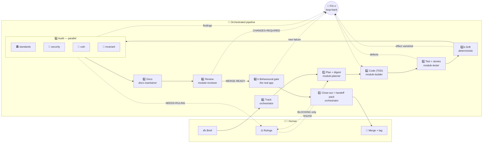
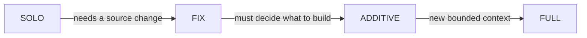
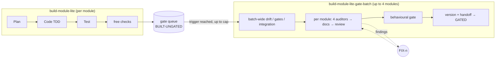
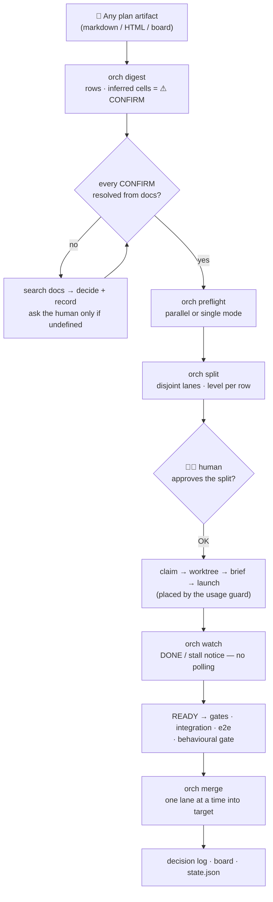
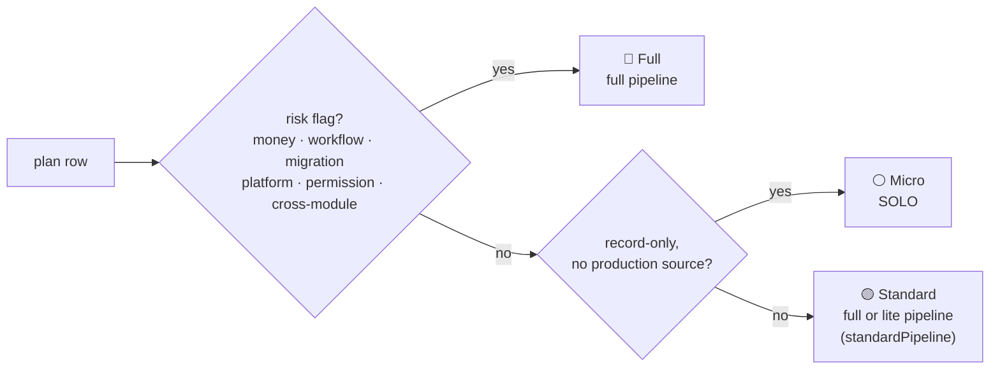
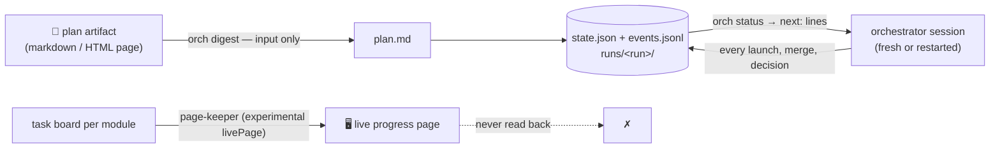
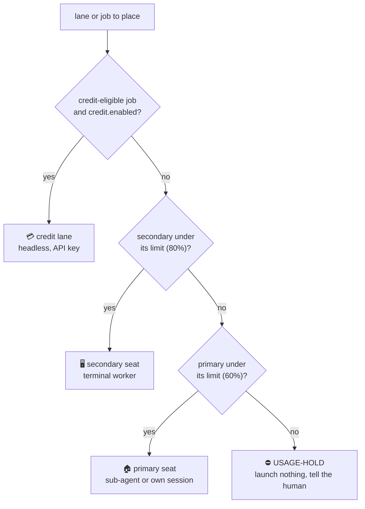
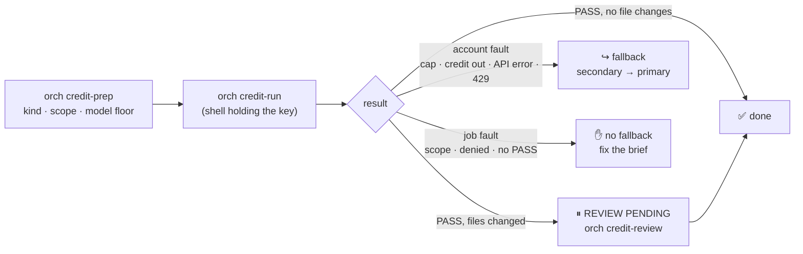
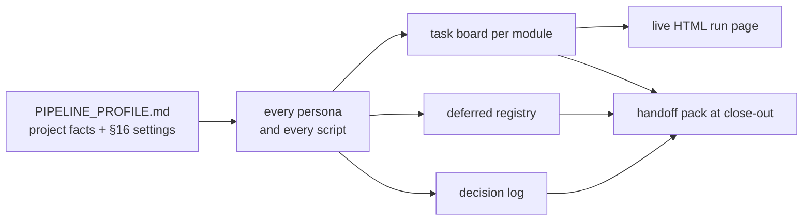

# 🧭 Guide — how the kit works

The deep dive behind [`README.md`](README.md), which covers install, setup and the commands. Every feature on one
page, with its command, per-tool support and status: [`FEATURES.md`](FEATURES.md). Operating a run:
[`USAGE.md`](USAGE.md). Why each rule exists: [`DESIGN.md`](DESIGN.md).

## 🗺️ The pipeline at a glance



Every dashed line is a **feedback loop**; the pipeline stops for a human only at brief-time
rulings, BLOCKERS, and the final merge — everything else self-corrects via the loop-back
protocol (same blocker twice → escalate to you).

## 🧠 The one-page mental model

| Principle | What it means |
|---|---|
| 🎼 **One orchestrator, nine personas** | The main agent never writes module code. It dispatches one fresh, role-scoped subagent per phase, threads *distilled artifacts* between them, and owns the gate-fail loop. One run = one branch, one board, one version bump — and one session. |
| 📄 **All specifics in one file** | Every persona loads `PIPELINE_PROFILE.md`. Personas define *how a phase behaves*; the profile defines *what is true in this project*, and its §16 holds the machine-readable settings every script reads. Port the kit by rewriting one file, not nine. |
| 📚 **Ledgers beat memory** | Git-tracked task board per module (the one progress surface), cross-module deferred registry, written plan + review per run, one handoff pack at close-out. Agents are stateless; the files are the truth. |
| 🖥️ **A run you can watch** | The board renders to one offline HTML page — step timeline, files produced, per-seat model / time / tokens / cost from the harness's own records. A watcher keeps it current; a row flip alone moves it. Unmeasured cells are em-dashes, never zeroes. |
| ⚔️ **Adversarial gates** | Tester extends (never rewrites) the coder's tests; four parallel auditors with different lenses — the fourth asking whether the system is still *coherent* afterwards, which no other seat and no test tier asks; the reviewer re-verifies every finding at its cited `file:line`. |
| 🧾 **Records checked by scripts** | Counts, citations, plan / findings / review shapes and the handoff pack are checked by scripts at the phase that writes them — before a reviewer spends judgement on them. |
| 🔎 **Every check declared** | An optional check the project cannot run prints `<feature>: not configured`. It never passes silently, and a half-configured feature fails validation. |
| ✅ **Every DONE is earned** | Close-out re-opens each row's evidence and checks the assertion *entails* the claim — the three fake-done shapes are hunted by name ([`DESIGN.md`](DESIGN.md) §11). |

## 👥 The nine personas

Each persona declares a **tier**, not a model; `PIPELINE_PROFILE.md` maps `strong` / `mid` to your harness's models.

| Phase | Persona | Tier | Writes | Job |
|---|---|---|---|---|
| 1 | `module-planner` | strong | plan only | Requirements → cited build plan + task board + blocker list |
| 2 | `module-builder` | strong | source + tests | TDD per board row: seeded failing test → red → green → refactor |
| 3 | `module-tester` | strong | tests only | Coverage gaps, real-datastore integration, permission matrix, forced-failure rollback |
| 4 | `standards-auditor` | strong | — | Boundaries, layering, contracts, naming |
| 4 | `security-auditor` | strong | — | AuthZ, scope, secrets/PII, input hardening |
| 4 | `vuln-auditor` | mid | — | Injection, double-apply, unbounded queries, I/O inside transactions |
| 4 | `invariant-auditor` | strong | — | Is the system still *coherent* after the call succeeded? |
| 5 | `docs-maintainer` | mid | docs only | API contract, module README, user docs |
| 6 | `module-reviewer` | strong | review only | Re-verifies every finding at its `file:line`; MERGE-READY or CHANGES-REQUIRED |

Auditors are read-only. A seat that finds a source defect reports it — only the coder fixes, via a `FIX-n` row.

## 🧭 Pick the rigour: tracks

Not every job is a module build. The track is chosen with the brief and confirmed by the planner.

| Track | Use for | Phases run |
|---|---|---|
| **FULL** | a new module / feature cluster | all — digest authored at P1 |
| **ADDITIVE** | a new field or operation on an existing module | all — digest refreshed; all four auditors kept |
| **PLATFORM** | shared / foundation code | all + named human authorization; standards auditor is primary; wiring check mandatory |
| **FIX** | a *verified* blocker list | all except the planner (the blocker list is the plan) |
| **RULINGS** | decision / doc-authority work | 0.5 → 1 → 7 — no coder, no tester |
| **SOLO** | ledger / docs / test-only | no pipeline, but declared — **never** for a production-source diff |



**The track is a floor, not a ceiling:** a run may escalate up mid-flight, never down (recorded as a board row).
Work that belongs to another module or track becomes a `SPLIT` finding — a deferred-registry row plus a proposed
separate run. The pipeline never starts another pipeline.

## ✂️ Lite split (experimental, `features.liteSplit`)

For throughput, the pipeline can be cut in two: build now, gate later in a batch.



Each module ends exactly where a full run would have left it. **Nothing merges until `GATED`.**

## 🎛️ Batch orchestrator (opt-in, `features.orchestrator`)

Above the module pipeline sits `orch` — a commander that runs a **whole plan** in parallel lanes. The orchestrator
session only routes and records; it never reads code. Fixed steps live in `scripts/orch.mjs`, judgement in the
`orchestrator` skill. State is a file, so a killed session resumes from `orch status`.



**Levels are set by rule and logged per row** — the orchestrator may raise one, never lower it:



Lanes never share a file (`orch claim` refuses overlap); each lane gets its own git worktree and branch. The lane
count starts at `maxLanes` and rises only with measured evidence that the machine and accounts carried the load.
Controls: `orch status` · `next` · `preflight` · `pause` · `stop` · `resume`.

### 🛰️ Progress, restarts and artifacts

The orchestrator is built to be killed. Its memory is **files in the repo**, never the conversation and never a
published page.



| What | Role | Survives a restart? |
|---|---|---|
| Plan artifact | **Input.** `orch digest` turns any markdown/HTML plan into rows | it is the source, not state |
| `state.json` + `events.jsonl` | **The run's state.** Lanes, levels, claims, approvals, launches, merges | yes — the first action of every session is `orch status`; it acts only on the `next:` lines |
| Task board + decision log | Per-module progress and every decision, git-tracked | yes |
| Live progress page (`features.livePage`, experimental) | A **one-way projection** of a module board for people to watch (per-seat model, time, tokens, cost) | rebuilt from the board; nothing reads state from it |

A restarted session re-arms a watcher for each lane still `LAUNCHED` and carries on. It never rebuilds a run from
scrollback, and it never reads state from a published page: the page can be stale, the files cannot.

### 👥 Multi-account seats

Work runs on **seats**: the primary account (where the orchestrator session lives), an optional secondary account
(terminal workers), and an optional API-credit lane. Usage is read fresh before every launch.



| Seat | Runs | Never runs |
|---|---|---|
| **Primary** (orchestrator account) | the orchestrator; SOLO lanes as sub-agents; pipeline lanes in their own session; the test slot and every merge | — |
| **Secondary** | lane workers in their own worktree (plan → build → test) | merges |
| **Credit lane** | bounded jobs: `code-reading`, `record-fixes`, `docs`, `sweeps`, the tester and the four auditor seats | building, planning, reviewing, orchestrating |

The primary limit sits below the secondary's because the orchestrator session itself runs there. Limits are
`features.orchestrator.limits`. The plan accounts never receive the API key.

### 💳 Credit lane (only with `credit.enabled`)



- **Meter + caps:** `orch credit` shows the period, spend across every worktree, what is left and the pace needed;
  `dailyCapUsd` stops one bad day spending the period. Running jobs reserve their budget under a machine-wide lock.
- **Lapsing budget:** `CREDIT-FILL` says how far behind pace spend is and names light jobs to queue.
- **Quality floors:** each job kind refuses a model below its floor (`models.strong` / `models.mid`); every prompt
  carries the evidence rules and must end `RESULT: PASS`.
- **Review hold fails closed:** `orch merge` refuses a lane while a credit job that changed its files is unreviewed.
- **Auditors on credit:** a lane parked at `WAIT-P4` gets its four auditors via `orch credit-audit`; if the credit
  lane is busy, the lane self-audits instead of waiting.

## 📚 Where the truth lives



Every build checks the deferred registry on entry (did I unblock a row?) and updates it on exit.

## 🧩 Extending

- **The profile.** `PIPELINE_PROFILE.md` is the one file that makes the kit concrete: project facts in §1–§15, and in
  §16 one `pipeline-settings` JSON block — commands (`commands.tier`, `typecheck`, …), paths (`paths.boards`,
  `registry`, `decisions`, …), model tiers, protected globs and every optional feature on or off. Every persona and
  every script reads it; nothing in the kit assumes a stack, a test runner or a folder layout of its own.
- **Overlays.** Keep a project's own version of a kit skill or persona instead of editing the kit's: record `keep`
  (yours only) or `both` (yours, plus the kit's as `builder-<name>`) with `npx builder choices set <kind>:<name>
  <keep|kit|both> --by <you>`. Upgrades honour it.
- **Local hooks and gates.** Your hooks stay yours; the kit's are copied, never armed (the settings blocks are in
  `adapters/<tool>.md`). Wire `npx builder check-ledgers` (and `check-targets` with qa-audit) into CI beside your own
  gates; an optional check the project cannot run prints `<feature>: not configured`, never a pass.

## 📦 What's in the box

```
builder-pipeline/   (the package; a folder copy is builder/)
├── 📖 README.md                  ← the short entry: install, setup, commands, per-tool support
├── 🧭 GUIDE.md                   ← you are here
├── 📋 FEATURES.md                ← every feature on one page: command, per-tool support, status
├── 🤖 llms.txt                   ← the doc map for AI agents (llms.txt convention)
├── 🧠 DESIGN.md                  ← WHY it works — 22 principles + failure lessons
├── 🧪 EXPERIMENTS.md             ← unproven items and the measurement that decides each
├── ⚡ SETUP_PROMPT.md            ← the one setup prompt (bootstrap, then the builder-init skill)
├── 🔧 UNPACK.md                  ← the folder-copy install path (secondary)
├── 🕹️ USAGE.md                   ← HOW to operate — stop points, record points, troubleshooting
├── 🔍 DISCOVERY.md               ← agent prompt: fill the profile (§1–§16) from the TARGET project
├── ⚙️ cli.js                     ← zero-dep Node CLI: bootstrap · inventory · choices · unpack ·
│                                    upgrade · verify · features · doctor · check-ledgers ·
│                                    check-targets · personas-check · run · targets
├── 🧩 cli/                       ← the setup commands' modules (inventory · bootstrap · doctor)
├── 📄 PIPELINE_PROFILE.template.md ← the ONE per-project file; §16 = pipeline settings (JSON)
├── 🤖 agents/                    ← 9 generic personas + experimental/ (page-keeper)
├── 📜 skills/                    ← recipes (pipeline · lite split · scaffold · readiness-check ·
│                                    setup) + the batch orchestrator above them (opt-in)
│                                    + references/ (index query block, review template)
├── 🧾 templates/                 ← ledger formats (module brief · task board · session board ·
│                                    deferred registry · decision log · developer-guide generator ·
│                                    orchestrator plan + worker brief)
├── 🎁 skills-extra/              ← optional utilities: caveman · graphify · ledger-audit ·
│                                    e2e-harness · qa-audit · repo-audit · adr
├── 🛡️ hooks/                     ← universal guards + claude-code/ (output cap · registry read
│                                    guard · reviewer write guard) — copied, never armed
├── 🔌 adapters/                  ← harness notes (claude-code · codex · antigravity · generic), incl. what each
│                                    Claude-Code-only step becomes elsewhere
├── 🛟 scripts/                   ← board tooling (progress · check-all · render · watch) and the
│                                    checkers: features · index-check · orchestrator-check ·
│                                    claims-check · citations-check · line-citations-check ·
│                                    output-check · handoff-pack / handoff-check · ledger-row ·
│                                    decision-index · wiring-check · spec-trace-check · instruction-budget ·
│                                    ratchet-refresh · fix-rate · seat-peaks · cost-window ·
│                                    contract-oracle · rules-module · mutation-step · orch (batch
│                                    orchestrator: lanes, seats, merge queue, credit lane) + lib/
├── 🔮 oracles/                   ← contract-oracle adapters (OpenAPI 3)
├── 📐 examples/                  ← ast-grep rules with fixtures · wiring/ (seam kinds for a
│                                    TypeScript DI service) · jest-tier-runner/ (one tier runner for
│                                    a JS project, + its instruction-trailer CI entry) — examples,
│                                    not defaults
├── 🧰 tooling/                   ← PORTING.md (the run economy) · optional/ (index sync with lock,
│                                    limit and session hook; caveman) · experimental/ (live page
│                                    shell · graph-trial report · persona generator)
├── ✅ tests/                     ← the kit's own suite (node tests/run.mjs in the kit repo; not shipped)
└── 🗒️ CHANGELOG.md               ← kit version history
```

## 🎁 Bundled utility skills (optional)

| Skill | Superpower | Badge |
|---|---|---|
| 🦴 **caveman** | ~75% token-cut reply mode with auto-clarity for warnings |  |
| 🕸️ **graphify** | repo → persistent queryable knowledge graph; cheap doc lookups |  |
| 🔎 **ledger-audit** | hunts unearned DONEs across boards, registry, trackers |  |
| 🧪 **e2e-harness** | OpenAPI-driven breadth e2e with a drift gate — model works only on the delta |  |
| 🛰️ **repo-audit** | whole-repo sweep through the auditor lenses + systemic-pattern synthesis |  |
| 📜 **adr** | house-format decision records; promote `DECISIONS.md` rulings to full ADRs |  |

Details + pipeline wiring: [`skills-extra/README.md`](skills-extra/README.md).

## 🧬 Provenance

Extracted 2026-08 from a production platform where this pipeline built 15+ modules, and uplifted
2026-09 with true accounting, record checkers, fixed output shapes, declared optional features and
labelled experiments. Every rule exists because its absence caused a real defect there; the war
stories are kept (anonymized) in [`DESIGN.md`](DESIGN.md) so future tuners know which rules are
load-bearing.

> 📶 Nothing the pack requires needs the internet. Badges and Mermaid diagrams are optional
> renderings: in an offline viewer the badges degrade to alt-text and the diagrams remain as
> readable code.