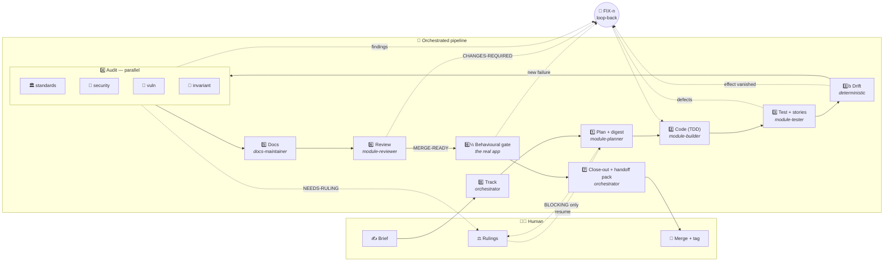
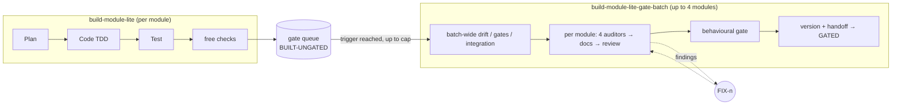
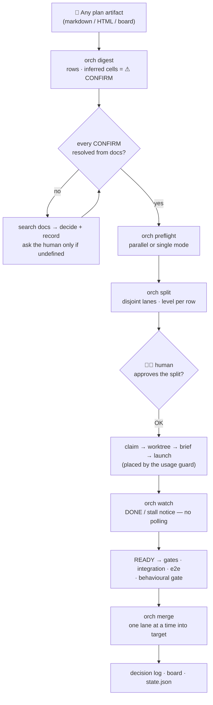
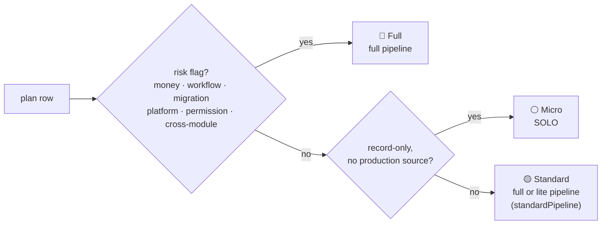
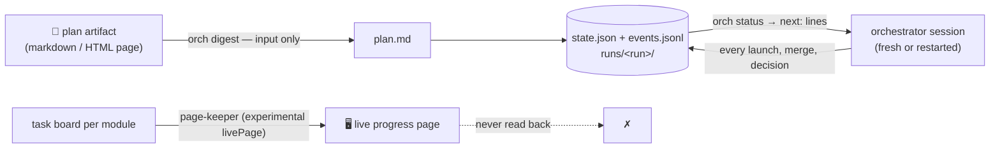
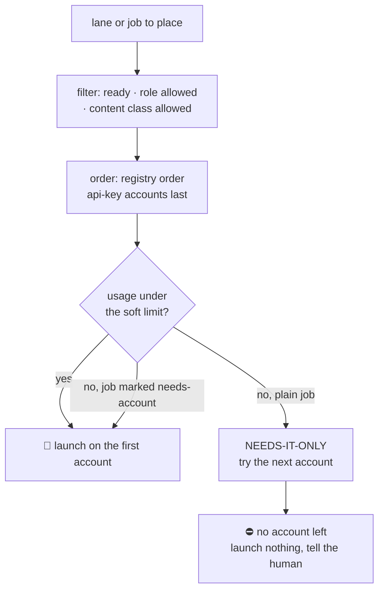
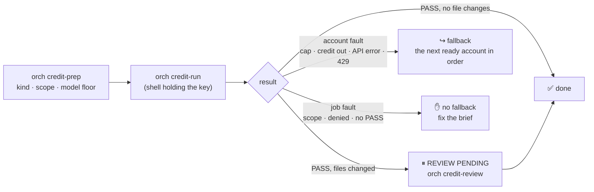
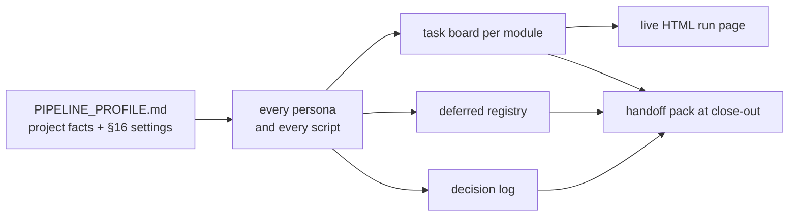

# 🧭 Guide — how the kit works

The deep dive behind [`README.md`](README.md), which covers install, setup and the commands. Every feature on one
page, with its command, per-tool support and status: [`FEATURES.md`](FEATURES.md). Operating a run:
[`USAGE.md`](USAGE.md). Why each rule exists: [`DESIGN.md`](DESIGN.md).

## 🗺️ The pipeline at a glance



Every dashed line is a **feedback loop**; the pipeline stops for a human only at brief-time
rulings, BLOCKERS, and the final merge — everything else self-corrects via the loop-back
protocol (same blocker twice → escalate to you).

## 🧠 The one-page mental model

| Principle | What it means |
|---|---|
| 🎼 **One orchestrator, nine personas** | The main agent never writes module code. It dispatches one fresh, role-scoped subagent per phase, threads *distilled artifacts* between them, and owns the gate-fail loop. One run = one branch, one board, one version bump — and one session. |
| 📄 **All specifics in one file** | Every persona loads `PIPELINE_PROFILE.md`. Personas define *how a phase behaves*; the profile defines *what is true in this project*, and its §16 holds the machine-readable settings every script reads. Port the kit by rewriting one file, not nine. |
| 📚 **Ledgers beat memory** | Git-tracked task board per module (the one progress surface), cross-module deferred registry, written plan + review per run, one handoff pack at close-out. Agents are stateless; the files are the truth. |
| 🖥️ **A run you can watch** | The board renders to one offline HTML page — step timeline, files produced, per-seat model / time / tokens / cost from the harness's own records. A watcher keeps it current; a row flip alone moves it. Unmeasured cells are em-dashes, never zeroes. |
| ⚔️ **Adversarial gates** | Tester extends (never rewrites) the coder's tests; four parallel auditors with different lenses — the fourth asking whether the system is still *coherent* afterwards, which no other seat and no test tier asks; the reviewer re-verifies every finding at its cited `file:line`. |
| 🧾 **Records checked by scripts** | Counts, citations, plan / findings / review shapes and the handoff pack are checked by scripts at the phase that writes them — before a reviewer spends judgement on them. |
| 🔎 **Every check declared** | An optional check the project cannot run prints `<feature>: not configured`. It never passes silently, and a half-configured feature fails validation. |
| ✅ **Every DONE is earned** | Close-out re-opens each row's evidence and checks the assertion *entails* the claim — the three fake-done shapes are hunted by name ([`DESIGN.md`](DESIGN.md) §11). |

## 👥 The nine personas

Each persona declares a **tier**, not a model; `PIPELINE_PROFILE.md` maps `strong` / `mid` to your harness's models.

| Phase | Persona | Tier | Writes | Job |
|---|---|---|---|---|
| 1 | `module-planner` | strong | plan only | Requirements → cited build plan + task board + blocker list |
| 2 | `module-builder` | strong | source + tests | TDD per board row: seeded failing test → red → green → refactor |
| 3 | `module-tester` | strong | tests only | Coverage gaps, real-datastore integration, permission matrix, forced-failure rollback |
| 4 | `standards-auditor` | strong | — | Boundaries, layering, contracts, naming |
| 4 | `security-auditor` | strong | — | AuthZ, scope, secrets/PII, input hardening |
| 4 | `vuln-auditor` | mid | — | Injection, double-apply, unbounded queries, I/O inside transactions |
| 4 | `invariant-auditor` | strong | — | Is the system still *coherent* after the call succeeded? |
| 5 | `docs-maintainer` | mid | docs only | API contract, module README, user docs |
| 6 | `module-reviewer` | strong | review only | Re-verifies every finding at its `file:line`; MERGE-READY or CHANGES-REQUIRED |

Auditors are read-only. A seat that finds a source defect reports it — only the coder fixes, via a `FIX-n` row.

## 🧭 Pick the rigour: tracks

Not every job is a module build. The track is chosen with the brief and confirmed by the planner.

| Track | Use for | Phases run |
|---|---|---|
| **FULL** | a new module / feature cluster | all — digest authored at P1 |
| **ADDITIVE** | a new field or operation on an existing module | all — digest refreshed; all four auditors kept |
| **PLATFORM** | shared / foundation code | all + named human authorization; standards auditor is primary; wiring check mandatory |
| **FIX** | a *verified* blocker list | all except the planner (the blocker list is the plan) |
| **RULINGS** | decision / doc-authority work | 0.5 → 1 → 7 — no coder, no tester |
| **SOLO** | ledger / docs / test-only | no pipeline, but declared — **never** for a production-source diff |


**The track is a floor, not a ceiling:** a run may escalate up mid-flight, never down (recorded as a board row).
Work that belongs to another module or track becomes a `SPLIT` finding — a deferred-registry row plus a proposed
separate run. The pipeline never starts another pipeline.

## ✂️ Lite split (experimental, `features.liteSplit`)

For throughput, the pipeline can be cut in two: build now, gate later in a batch.



Each module ends exactly where a full run would have left it. **Nothing merges until `GATED`.**

## 🎛️ Batch orchestrator (opt-in, `features.orchestrator`)

Above the module pipeline sits `orch` — a commander that runs a **whole plan** in parallel lanes. The orchestrator
session only routes and records; it never reads code. Fixed steps live in `scripts/orch.mjs`, judgement in the
`orchestrator` skill. State is a file, so a killed session resumes from `orch status`.



**Levels are set by rule and logged per row** — the orchestrator may raise one, never lower it:



Lanes never share a file (`orch claim` refuses overlap); each lane gets its own git worktree and branch. A worktree
separates working files; it does not sandbox processes and it does not prevent merge conflicts. The lane
count starts at `maxLanes` and rises only with measured evidence that the machine and accounts carried the load.
Controls: `orch status` · `next` · `preflight` · `pause` · `stop` · `resume`.

A remote lane (`features.remoteLanes`, experimental) runs on another machine. It works in its own clone there and exchanges work through the origin both hosts reach. The kit never mounts, copies or syncs a worktree: Git's own FAQ warns against sharing a working tree across systems, because the index and the file times disagree. A person logs the remote machine in once; no credential leaves this machine.

### 🛰️ Progress, restarts and artifacts

The orchestrator is built to be killed. Its memory is **files in the repo**, never the conversation and never a
published page.



| What | Role | Survives a restart? |
|---|---|---|
| Plan artifact | **Input.** `orch digest` turns any markdown/HTML plan into rows | it is the source, not state |
| `state.json` + `events.jsonl` | **The run's state.** Lanes, levels, claims, approvals, launches, merges | yes — the first action of every session is `orch status`; it acts only on the `next:` lines |
| Task board + decision log | Per-module progress and every decision, git-tracked | yes |
| Live progress page (`features.livePage`, experimental) | A **one-way projection** of a module board for people to watch (per-seat model, time, tokens, cost) | rebuilt from the board; nothing reads state from it |

A restarted session re-arms a watcher for each lane still `LAUNCHED` and carries on. It never rebuilds a run from
scrollback, and it never reads state from a published page: the page can be stale, the files cannot.

### 👥 Accounts

Work runs on **accounts**. The registry is `features.accounts` in §16 of `PIPELINE_PROFILE.md`. One entry is one
account. Each account names its worker (`session`, `claude-code`, `codex`, `api-key`), who pays (`subscription`,
`gateway`, `free`, `api-key`), a content class (`public`, `scratch`, `any`, or a list of path roots), its roles, a
family, a config dir, a start command and a budget (`percent` or `usd`, with a soft and a hard value). Account names
are lowercase, at most 16 characters, and never a reserved word. A value shaped like a secret is refused at load; the
refusal names the kind and never the text.

> **Commands.** Written for the npm-package install: the CLI is `npx builder-pipeline <command>` and a kit script runs as
> `npx builder-pipeline run <name>`. With the kit copied in as a `builder/` folder ([`UNPACK.md`](UNPACK.md)), the CLI is
> `node builder/cli.js <command>` and a script runs from the project's `scripts/` copy with Node (folder layout).

**The report.** `npx builder-pipeline accounts` prints one block per account: the state (`ready`, `not ready` with its
reason, or `unmeasured`), the usage reading with its source and time, the version and the note. It exits 1 when one
account is not ready. `--json` prints the same facts and exits 0. While the feature is off, it prints
`accounts: not configured`. A reading is `measured`, `estimate` or `unmeasured`; the report never prints `0 %` for a
reading nobody took. `npx builder-pipeline doctor` prints the same lines as advisory rows; its exit code does not change.

**The commands.** Each command changes the registry in §16 only, and nothing else in the profile.

| Command | What it does |
|---|---|
| `npx builder-pipeline accounts` | the readiness report, one block per account |
| `npx builder-pipeline accounts add <name> --worker <w> --pays <p> [--roles ...] [--content ...]` | add one account to the registry and create its account dir |
| `npx builder-pipeline accounts note <name> "<text>"` | set the account's `note`; the orchestrator obeys the note as a rule |
| `npx builder-pipeline accounts key <name>` | store the key of an `api-key` account in its key file, read from a prompt; the key never enters the profile |
| `npx builder-pipeline accounts remove <name>` | remove the account from the registry; its key file is deleted, its config dir is kept |
| `npx builder-pipeline accounts list` | the registry in order, one line per account |
| `npx builder-pipeline accounts migrate [--dry-run]` | rewrite the 1.0 seat keys into accounts (see below) |

**Placement.** The orchestrator places a lane with one rule, inside `orch next`, `orch claim` and
`orch gate-launch`:



- A lane needs the module-builder role. A headless job (a tester, an auditor, a credit job) needs only its own role.
- At or above `budget.hard` the account is not ready. At or above the soft limit (`budget.soft`, else
  `softLimitPct`) the account takes only a job marked needs-account.
- A reading older than `usageStaleMinutes` is unmeasured. Only the first account in order may launch unmeasured.
- `orch next` prints one `SKIP <account>: <why>` line per account it passes over. `orch status` prints one line
  per account with its state and reading.
- A `LIMIT`, `BUDGET` or `AUTH` fault marks the account not ready until its `until` time. The job runs once more on
  the next ready account. An `OVERLOAD` fault retries the same account with a backoff; it never changes the account.
- `features.accounts.placement: shadow` computes the account the rule would pick, records it as a
  `placement.shadow` event, and places the 1.0 way (the first ready account in order).

**The policy gate and the pin.** Before a launch, `orch gate-launch` checks the account against the project. It
refuses with exit 3 when: the account's content class does not fit the project's `visibility` (§1 of the profile);
a claimed file lies outside the account's path roots; a `free` or `gateway` account, or an account with a
`baseUrl`, has no decision-log row that names it; or a settings file carries `apiKeyHelper`, an `env.ANTHROPIC_*`
variable, a proxy variable or a hook not recorded in `builder.lock.json`. The refusal names the key and the file,
never a value. A passing launch writes the account's `--settings` pin to `<run>/pins/<lane>.settings.json`: the
account's env block, its config dir, its `baseUrl` and the deny rules of a path-root account. The pin never holds a
key. Each lane runs in its own git worktree on a fresh branch. A worktree separates working files; it does not
sandbox processes and it does not prevent merge conflicts.

**The rulebook.** The judgement parts of placement are in `skills/references/account-selection.md`. `unpack`
installs it beside the pipeline skill. The orchestrator skill (§3) points at it. It covers: ready only, the content
class, the roles, the budget, the pays order with `api-key` last, holds, resume, drafts, shadow mode, and the list
of things an orchestrator never does. The `note` of an account is a rule in that book, not a comment.

#### Migrating from 1.0 seats

The 1.0 keys `features.orchestrator.seats`, `limits`, `secondaryConfigDir` and `credit` are gone in 2.0. While the
orchestrator is on, the loader refuses them. While it is off, the loader prints one warning. Both name the fix:

1. Run `npx builder-pipeline accounts migrate --dry-run`. Read the notes.
2. Run `npx builder-pipeline accounts migrate`. It rewrites the `pipeline-settings` block of `PIPELINE_PROFILE.md` once.
   `primary` becomes the `session` account. `secondary` becomes a `claude-code` account with its config dir and start
   command. `credit` becomes an `api-key` account with a USD budget and the credit guards. Every byte outside the
   block stays.
3. The command writes `PIPELINE_PROFILE.md.bak` first. Keep it until the first run is green.
4. A second run changes nothing. The command is idempotent.
5. The command refuses while a run holds a `LAUNCHED` or `STALLED` lane. Finish or stop the run (`orch status`),
   then migrate.
6. Finished run states keep their `seats`; `migrate` adds the `accounts` list beside them and archives each original
   as `state.json.bak`. The placement decisions of 1.0 are kept; the golden fixture proves it.

`npx builder-pipeline doctor` shows the state before and after: one row reads `profile: legacy seats, run npx builder-pipeline
accounts migrate` until the rewrite is done.

#### Looping a board

The `boardLoop` key of the settings block (experimental, off by default) lets the orchestrator run one module board
to its end without a person between the steps: `npx builder-pipeline run board-loop <account> <board>`, or `orch loop <board>` from the
orchestrator skill. The loop places each step on the named account with the rule above and stops at every stop point
the board declares. No measurements exist yet for this feature. It stays `experimental-off` until a measured run
shows that the loop keeps the same gates as a person-driven board ([EXPERIMENTS.md](EXPERIMENTS.md)). It lands in
its own change; a kit without the key prints `boardLoop: not configured`.

### 🧭 Capacity governor (`features.capacity`, default off; 2.1.0)

The governor caps the number of lanes that run at the same time by what the machine and the accounts can carry. It
is one more term in the lane-cap rule the orchestrator already has: effective lanes = min(`maxLanes`, the 429 cap,
the governor's record). It lowers only. It never raises a cap, never stops a running lane and never signals a process;
`ADD-LANES` and `split --max-lanes` stay with the person.

Signals, each with a source: free memory against `perLaneMb` and `minFreeMb`, cores minus `reserveCores`, the
one-minute load against `maxLoadPerCore` (Unix only; `os.loadavg()` is zero on Windows, so load is unmeasured there),
free disk against `minDiskMb`, the accounts that are ready and under their soft limit, and the 429 record. An
unmeasured signal never binds, and the record says so. A drop applies at once; a rise applies by one lane after
`riseAfterTicks` ticks that allow it. Every line names the figure and its unit, never only a ratio.

Set it up: turn `features.capacity` on in §16 and fill `perLaneMb` with this project's measured per-lane peak RSS.
The loop runner writes `passPeakRssMb` into each pass row of `.pipeline/loop/<board>.jsonl` while the feature is on,
so run a board loop once and read the figure from there (the kit's own figure is in [EXPERIMENTS §21](EXPERIMENTS.md)).
Then start the watcher at run start beside the board watcher:

```bash
npx builder-pipeline run capacity --once            # one tick: write <orch root>/capacity.json and print the table
npx builder-pipeline run capacity --watch           # tick every intervalSeconds; one watcher per orch root holds a pid lease
```

`orch next` prints `CAPACITY: lanes capped at N of M — <signal>` while the record binds, `gate-launch --resume` counts
it as a slot limit, `orch status` prints one `capacity:` line and `doctor` adds one advisory row. The loop runner reads
the record before each pass: at 0 lanes it waits `intervalSeconds` and reads again, up to `holdMaxMinutes`, then stops
with the reason `capacity`. A record older than `ttlSeconds` is ignored, and the reader says so: the pipeline fails
open on a dead watcher, never closed. When the line has bound for `explainAfterTicks` ticks, the read-only
`capacity-steward` persona explains the binding signal in words and drafts one profile change and one decision row.
Numbers come from the script; words come from the persona (plan decision D70).

### 💳 Credit lane (only with an `api-key` account)



- **Meter + caps:** `orch credit` shows the period, spend across every worktree, what is left and the pace needed;
  `dailyCapUsd` stops one bad day spending the period. Running jobs reserve their budget under a machine-wide lock.
- **Lapsing budget:** `CREDIT-FILL` says how far behind pace spend is and names light jobs to queue.
- **Quality floors:** each job kind refuses a model below its floor (`models.strong` / `models.mid`); every prompt
  carries the evidence rules and must end `RESULT: PASS`.
- **Review hold fails closed:** `orch merge` refuses a lane while a credit job that changed its files is unreviewed.
- **Auditors on credit:** a lane parked at `WAIT-P4` gets its four auditors via `orch credit-audit`; if the credit
  lane is busy, the lane self-audits instead of waiting.

## 🔑 Accounts and wrappers (`features.accounts`)

One person, several accounts. §16 `features.accounts` lists them: who the worker is (`claude-code`, `codex` or the
session itself), who pays (`subscription`, `gateway`, `free`, `api-key`), what content the account may see, which roles
it may hold, and a budget. Keys never live in the profile: `npx builder-pipeline accounts key <name>` stores one with echo off
in the account's own folder under the accounts home (`~/.builder-pipeline`, or `BUILDER_ACCOUNTS_HOME`).

`npx builder-pipeline accounts install` writes one wrapper pair per account, `bin/<name>` and `bin/<name>.ps1`, and the
account's composed settings. A wrapper does four things: it unsets the denylist (nothing of a parent session's
Anthropic, Claude, OpenAI, Codex or Gemini setup, no Node preload, no proxy or CA override, no XDG config), it checks
the account's sandbox-runtime settings, it points the tool at the account's own config dir, and it starts the tool. No
wrapper exports a key: a Claude Code account reads its token through `apiKeyHelper`; a Codex gateway account binds one
provider entry to one budget-capped key. A subscription account's settings never name a base URL.

Every file the install writes is recorded in `accounts.lock.json` under the accounts home. A file changed since the kit
wrote it is kept and named; `--force` backs it up first and replaces it. Nothing is armed in a live tool configuration:
the files sit in kit-created folders only, and the free-model MCP registration is printed, never written.

**Gateway and free accounts.** A gateway fronts API keys, never a subscription. The gateway policy
(`<accounts home>/gateway/policy.json`, no secrets) says the budget, the model pool, the pricing rows and one profile.
`npx builder-pipeline accounts policy show | dry-run | apply` drives the gateway through a pinned adapter (OmniRoute pinned per
version with a golden request plan; Bifrost declared, not yet pinned): the management token comes from a 0600 file, the
client never follows a redirect, plain http reaches loopback only, and every error is reduced to the method, the path
and the status. `apply` records a marker with the policy's sha256 and the gateway version; `builder verify` reads that
marker and shows drift as an advisory row, without touching the network. A policy that closes the free lane makes
`accounts install` write a refusal wrapper that only explains why (its marker line is `# builder-pipeline: closed`); an
unreadable policy leaves a working wrapper alone. `npx builder-pipeline accounts usage-snapshot` writes per-key spend and budget
as numbers the readiness assessment reads, never a token or a key.

**Sandbox-runtime settings.** Each Claude Code account gets `srt-settings.json`: `denyRead` lists every other account
dir and your own `~/.claude` and `~/.codex`, `allowWrite` lists the lane worktree, and the credentials block masks the
account key and injects it toward the account's API host only. The wrapper passes the file to `srt` when that tool is
present, and refuses the launch naming the file when it is invalid.

## ⬆️ From 1.x: the command name

2.0.0 has one command, `builder-pipeline`. The 1.x package also installed a second command, `builder`; that name
belongs to an unrelated package on the npm registry, so 2.0.0 drops it. Every file the kit ships and every file it
installs already says `npx builder-pipeline <cmd>` and `npx builder-pipeline run <name>`.

Your own files are not rewritten: `upgrade` never touches project-owned files (your scripts, your CI workflow, your
`AGENTS.md` or `CLAUDE.md` text outside the kit's pointer block). In those files, change the command name after `npx`
from `builder` to `builder-pipeline` yourself, then run `npx builder-pipeline verify`. The file names
`builder.lock.json`, `builder.config.json` and `builder.choices.json` do not change, and neither does the
folder layout form, `node builder/cli.js <cmd>`.

## 📚 Where the truth lives



Every build checks the deferred registry on entry (did I unblock a row?) and updates it on exit.

## 🧩 Extending

- **The profile.** `PIPELINE_PROFILE.md` is the one file that makes the kit concrete: project facts in §1–§15, and in
  §16 one `pipeline-settings` JSON block — commands (`commands.tier`, `typecheck`, …), paths (`paths.boards`,
  `registry`, `decisions`, …), model tiers, protected globs and every optional feature on or off. Every persona and
  every script reads it; nothing in the kit assumes a stack, a test runner or a folder layout of its own.
- **Overlays.** Keep a project's own version of a kit skill or persona instead of editing the kit's: record `keep`
  (yours only) or `both` (yours, plus the kit's as `builder-<name>`) with `npx builder-pipeline choices set <kind>:<name>
  <keep|kit|both> --by <you>`. Upgrades honour it.
- **Local hooks and gates.** Your hooks stay yours; the kit's are copied, never armed (the settings blocks are in
  `adapters/<tool>.md`). Wire `npx builder-pipeline check-ledgers` (and `check-targets` with qa-audit) into CI beside your own
  gates; an optional check the project cannot run prints `<feature>: not configured`, never a pass.

## 📦 What's in the box

```
builder-pipeline/   (the package; a folder copy is builder/)
├── 📖 README.md                  ← the short entry: install, setup, commands, per-tool support
├── 🧭 GUIDE.md                   ← you are here
├── 📋 FEATURES.md                ← every feature on one page: command, per-tool support, status
├── 🤖 llms.txt                   ← the doc map for AI agents (llms.txt convention)
├── 🧠 DESIGN.md                  ← WHY it works — 22 principles + failure lessons
├── 🧪 EXPERIMENTS.md             ← unproven items and the measurement that decides each
├── ⚡ SETUP_PROMPT.md            ← the one setup prompt (bootstrap, then the builder-init skill)
├── 🔧 UNPACK.md                  ← the folder-copy install path (secondary)
├── 🕹️ USAGE.md                   ← HOW to operate — stop points, record points, troubleshooting
├── 🔍 DISCOVERY.md               ← agent prompt: fill the profile (§1–§16) from the TARGET project
├── ⚙️ cli.js                     ← zero-dep Node CLI: bootstrap · inventory · choices · unpack ·
│                                    upgrade · verify · features · doctor · check-ledgers ·
│                                    check-targets · personas-check · run · targets
├── 🧩 cli/                       ← the setup commands' modules (inventory · bootstrap · doctor)
├── 📄 PIPELINE_PROFILE.template.md ← the ONE per-project file; §16 = pipeline settings (JSON)
├── 🤖 agents/                    ← 9 generic personas + experimental/ (page-keeper)
├── 📜 skills/                    ← recipes (pipeline · lite split · scaffold · readiness-check ·
│                                    setup · spec-author) + the batch orchestrator above them (opt-in)
│                                    + references/ (index query block, review template)
├── 🧾 templates/                 ← ledger formats (spec · module brief · task board · session board ·
│                                    deferred registry · decision log · developer-guide generator ·
│                                    orchestrator plan + worker brief)
├── 🎁 skills-extra/              ← optional utilities: caveman · graphify · ledger-audit ·
│                                    e2e-harness · qa-audit · repo-audit · adr
├── 🛡️ hooks/                     ← universal guards + claude-code/ (output cap · registry read
│                                    guard · reviewer write guard) — copied, never armed
├── 🔌 adapters/                  ← harness notes (claude-code · codex · antigravity · generic), incl. what each
│                                    Claude-Code-only step becomes elsewhere
├── 🛟 scripts/                   ← board tooling (progress · check-all · render · watch) and the
│                                    checkers: features · index-check · orchestrator-check ·
│                                    claims-check · citations-check · line-citations-check ·
│                                    output-check · handoff-pack / handoff-check · ledger-row ·
│                                    decision-index · wiring-check · spec-trace-check · instruction-budget ·
│                                    ratchet-refresh · fix-rate · seat-peaks · cost-window ·
│                                    contract-oracle · rules-module · mutation-step · orch (batch
│                                    orchestrator: lanes, seats, merge queue, credit lane) + lib/
├── 🔮 oracles/                   ← contract-oracle adapters (OpenAPI 3)
├── 📐 examples/                  ← ast-grep rules with fixtures · wiring/ (seam kinds for a
│                                    TypeScript DI service) · jest-tier-runner/ (one tier runner for
│                                    a JS project, + its instruction-trailer CI entry) — examples,
│                                    not defaults
├── 🧰 tooling/                   ← PORTING.md (the run economy) · optional/ (index sync with lock,
│                                    limit and session hook; caveman) · experimental/ (live page
│                                    shell · graph-trial report · persona generator)
├── ✅ tests/                     ← the kit's own suite (node tests/run.mjs in the kit repo; not shipped)
└── 🗒️ CHANGELOG.md               ← kit version history
```

## 🎁 Bundled utility skills (optional)

| Skill | Superpower | Badge |
|---|---|---|
| 🦴 **caveman** | ~75% token-cut reply mode with auto-clarity for warnings |  |
| 🕸️ **graphify** | repo → persistent queryable knowledge graph; cheap doc lookups |  |
| 🔎 **ledger-audit** | hunts unearned DONEs across boards, registry, trackers |  |
| 🧪 **e2e-harness** | OpenAPI-driven breadth e2e with a drift gate — model works only on the delta |  |
| 🛰️ **repo-audit** | whole-repo sweep through the auditor lenses + systemic-pattern synthesis |  |
| 📜 **adr** | house-format decision records; promote `DECISIONS.md` rulings to full ADRs |  |

Details + pipeline wiring: [`skills-extra/README.md`](skills-extra/README.md).

## 🧬 Provenance

Extracted 2026-08 from one production backend, where its author built and used it, and uplifted
2026-09 with true accounting, record checkers, fixed output shapes, declared optional features and
labelled experiments. That project's data cannot ship (the kit keeps no project ids); published
measurements start with 2.0.0 ([`EXPERIMENTS.md`](EXPERIMENTS.md)). Every rule exists because its
absence caused a real defect there; the war stories are kept (anonymized) in [`DESIGN.md`](DESIGN.md)
so future tuners know which rules are load-bearing.

> 📶 Nothing the pack requires needs the internet. Badges and Mermaid diagrams are optional
> renderings: in an offline viewer the badges degrade to alt-text and the diagrams remain as
> readable code.