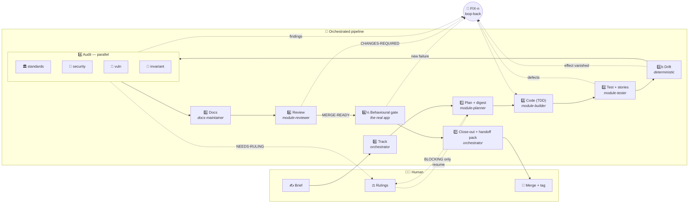
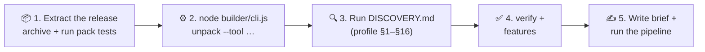

# 🏗️ Builder — a portable multi-agent module-factory kit

<p align="center">
  
  
  
  
  
  
  
  
</p>

A self-contained, project-agnostic packaging of the **build-module-pipeline** mechanism proven on
a production modular-monolith backend (15+ shipped modules): an orchestrated, persona-per-phase
agent pipeline that builds one feature module at a time — planned, coded TDD-first, tested
adversarially, audited in parallel, documented, and gate-reviewed — with durable ledgers so no
work is silently lost and no "done" is unearned.

> **Inert by design.** Nothing activates in a repo that merely *contains* `builder/` — no agents,
> skills, hooks, or config register until you run the unpack CLI in the target repo. And the kit
> never imports its source project's rules: `PIPELINE_PROFILE.md` is filled by reading the
> **target** project's own docs (the [`DISCOVERY.md`](DISCOVERY.md) step).

---

## 🗺️ The pipeline at a glance



Every dashed line is a **feedback loop**; the pipeline stops for a human only at brief-time
rulings, BLOCKERS, and the final merge — everything else self-corrects via the loop-back
protocol (same blocker twice → escalate to you).

## 🧠 The one-page mental model

| Principle | What it means |
|---|---|
| 🎼 **One orchestrator, nine personas** | The main agent never writes module code. It dispatches one fresh, role-scoped subagent per phase, threads *distilled artifacts* between them, and owns the gate-fail loop. One run = one branch, one board, one version bump — and one session. |
| 📄 **All specifics in one file** | Every persona loads `PIPELINE_PROFILE.md`. Personas define *how a phase behaves*; the profile defines *what is true in this project*, and its §16 holds the machine-readable settings every script reads. Port the kit by rewriting one file, not nine. |
| 📚 **Ledgers beat memory** | Git-tracked task board per module (the one progress surface), cross-module deferred registry, written plan + review per run, one handoff pack at close-out. Agents are stateless; the files are the truth. |
| 🖥️ **A run you can watch** | The board renders to one offline HTML page — step timeline, files produced, per-seat model / time / tokens / cost from the harness's own records. A watcher keeps it current; a row flip alone moves it. Unmeasured cells are em-dashes, never zeroes. |
| ⚔️ **Adversarial gates** | Tester extends (never rewrites) the coder's tests; four parallel auditors with different lenses — the fourth asking whether the system is still *coherent* afterwards, which no other seat and no test tier asks; the reviewer re-verifies every finding at its cited `file:line`. |
| 🧾 **Records checked by scripts** | Counts, citations, plan / findings / review shapes and the handoff pack are checked by scripts at the phase that writes them — before a reviewer spends judgement on them. |
| 🔎 **Every check declared** | An optional check the project cannot run prints `<feature>: not configured`. It never passes silently, and a half-configured feature fails validation. |
| ✅ **Every DONE is earned** | Close-out re-opens each row's evidence and checks the assertion *entails* the claim — the three fake-done shapes are hunted by name ([`DESIGN.md`](DESIGN.md) §11). |

## 📦 What's in the box

```
builder/
├── 📖 README.md                  ← you are here
├── 🧠 DESIGN.md                  ← WHY it works — 22 principles + failure lessons
├── 🧪 EXPERIMENTS.md             ← unproven items and the measurement that decides each
├── ⚡ SETUP_PROMPT.md            ← paste-into-agent bootstrap — drives the whole setup end-to-end
├── 🔧 UNPACK.md                  ← receiving the pack + HOW to install (agent-executable)
├── 🕹️ USAGE.md                   ← HOW to operate — stop points, record points, troubleshooting
├── 🔍 DISCOVERY.md               ← agent prompt: fill the profile (§1–§16) from the TARGET project
├── ⚙️ cli.js                     ← zero-dep Node CLI: unpack · targets · verify · features ·
│                                    check-ledgers · check-targets
├── 📄 PIPELINE_PROFILE.template.md ← the ONE per-project file; §16 = pipeline settings (JSON)
├── 🤖 agents/                    ← 9 generic personas + experimental/ (page-keeper)
├── 📜 skills/                    ← 4 recipes (pipeline · scaffold · readiness-check · setup)
│                                    + references/ (index query block, review template)
├── 🧾 templates/                 ← ledger formats (module brief · task board · session board ·
│                                    deferred registry · decision log · developer-guide generator)
├── 🎁 skills-extra/              ← optional utilities: caveman · graphify · ledger-audit ·
│                                    e2e-harness · qa-audit · repo-audit · adr
├── 🛡️ hooks/                     ← universal guards + claude-code/ (output cap · registry read
│                                    guard · reviewer write guard) — copied, never armed
├── 🔌 adapters/                  ← harness notes (claude-code · codex · generic), incl. what each
│                                    Claude-Code-only step becomes elsewhere
├── 🛟 scripts/                   ← board tooling (progress · check-all · render · watch) and the
│                                    checkers: features · index-check · orchestrator-check ·
│                                    claims-check · output-check · handoff-pack / handoff-check ·
│                                    ledger-row · fix-rate · seat-peaks · cost-window ·
│                                    contract-oracle · rules-module · mutation-step + lib/
├── 🔮 oracles/                   ← contract-oracle adapters (OpenAPI 3)
├── 📐 examples/                  ← ast-grep rules with fixtures · jest-tier-runner/ (one tier
│                                    runner for a JS project) — examples, not defaults
├── 🧰 tooling/                   ← PORTING.md (the run economy) · optional/ (index sync, caveman) ·
│                                    experimental/ (live page shell)
├── ✅ tests/                     ← the pack's own suite: node builder/tests/run.mjs
└── 🗒️ CHANGELOG.md               ← kit version history
```

## 🚀 Quick start

> **⚡ Zero-thought path:** put `builder/` in the repo, then paste
> [`SETUP_PROMPT.md`](SETUP_PROMPT.md) into your agent — it drives every step below
> (detect harness → unpack → discovery incl. §16 → confirm batch → hardening offer → verify →
> dry run), **generates a project-specific `DEVELOPER_GUIDE.md`** for your team, and installs
> itself as the `setup-builder` skill for re-runs and upgrades. The manual steps:



**1.** Extract a release archive of the pack at the target repo root — never copy a working
directory that contains `builder/.git` ([`UNPACK.md`](UNPACK.md) § Receive the pack). Then prove the
pack itself works (Node 18 or newer):

```
node builder/tests/run.mjs
```

**2.** Unpack for your tool(s) — one command, safe to re-run, never overwrites:

```
node builder/cli.js unpack --tool <your-agent>
```

No target is privileged: personas ship with **harness-neutral frontmatter** (`capabilities` +
`tier` + optional `effort`); an adapter with a native agent format transforms it at install time,
every other harness consumes the same files as prompt text. Experimental items install only with
`--experimental`.

<details>
<summary><b>Supported <code>--tool</code> targets (10)</b></summary>

| Target | Harness | Install style |
|---|---|---|
| `claude-code` | Claude Code | `.claude/agents/` + `.claude/skills/` (frontmatter transformed: capabilities/tier/effort → tools/model/effort) |
| `codex` | OpenAI Codex CLI | `.builder/` + pointer in `AGENTS.md` |
| `opencode` | OpenCode | `.builder/` + pointer in `AGENTS.md` |
| `gemini` | Gemini CLI | `.builder/` + pointer in `GEMINI.md` |
| `cursor` | Cursor | `.builder/` + rule in `.cursor/rules/*.mdc` |
| `copilot` | GitHub Copilot | `.builder/` + `.github/copilot-instructions.md` |
| `windsurf` | Windsurf | `.builder/` + `.windsurf/rules/` |
| `cline` | Cline / Roo Code | `.builder/` + `.clinerules/` |
| `aider` | aider | `.builder/` + pointer in `CONVENTIONS.md` |
| `generic` | anything else | `.builder/` + pointer in `AGENTS.md` |

Comma-separate several, or `--tool all`. Preview with `--dry-run`; list with
`node builder/cli.js targets`; skip utility skills with `--no-extras`.

</details>

**3.** Open [`DISCOVERY.md`](DISCOVERY.md) in your AI agent — it fills `PIPELINE_PROFILE.md` from
**this target project's own docs**, including §16 (commands, paths, models, protected globs, and
each optional feature on or off from what the project actually has), and asks you only what docs
can't answer.

**4.** Check the result:

```
node builder/cli.js verify
node scripts/features.mjs
```

`verify` confirms the install, that the profile is filled, and that the §16 settings block is
valid. `features.mjs` prints every feature's state — `on`, `not configured`, `unmeasured`, or
experimental. (Later, `check-ledgers` is the CI-ready gate over boards + registry, `check-targets`
guards the qa-audit environment config so a shared datastore can never be audited destructively,
and [`hooks/`](hooks/README.md) holds the opt-in guards.)

**5.** Write a module brief from `specs/module-brief.template.md` and tell the agent:
*"Build the `<X>` module through the pipeline."*

From here, [`USAGE.md`](USAGE.md) is your operator's runbook — the stop points where the pipeline
waits for you, the record points it writes, how to resume an interrupted build, and the
troubleshooting table.

## 🎁 Bundled utility skills (optional)

| Skill | Superpower | Badge |
|---|---|---|
| 🦴 **caveman** | ~75% token-cut reply mode with auto-clarity for warnings |  |
| 🕸️ **graphify** | repo → persistent queryable knowledge graph; cheap doc lookups |  |
| 🔎 **ledger-audit** | hunts unearned DONEs across boards, registry, trackers |  |
| 🧪 **e2e-harness** | OpenAPI-driven breadth e2e with a drift gate — model works only on the delta |  |
| 🛰️ **repo-audit** | whole-repo sweep through the auditor lenses + systemic-pattern synthesis |  |
| 📜 **adr** | house-format decision records; promote `DECISIONS.md` rulings to full ADRs |  |

Details + pipeline wiring: [`skills-extra/README.md`](skills-extra/README.md).

## 🧬 Provenance

Extracted 2026-08 from a production platform where this pipeline built 15+ modules, and uplifted
2026-09 with true accounting, record checkers, fixed output shapes, declared optional features and
labelled experiments. Every rule exists because its absence caused a real defect there; the war
stories are kept (anonymized) in [`DESIGN.md`](DESIGN.md) so future tuners know which rules are
load-bearing.

> 📶 Nothing the pack requires needs the internet. Badges and Mermaid diagrams are optional
> renderings: in an offline viewer the badges degrade to alt-text and the diagrams remain as
> readable code.
