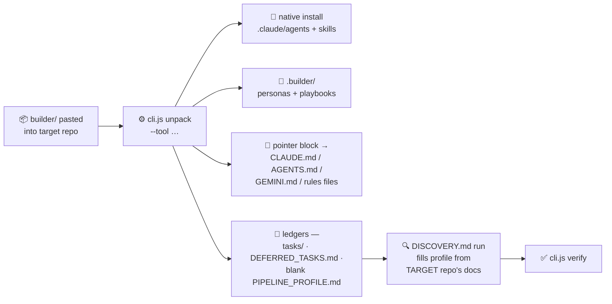

# 🔧 UNPACK — installing the builder kit into a project

<p align="center">
  
  
  
</p>



**The zero-thought path:** paste [`SETUP_PROMPT.md`](SETUP_PROMPT.md) into your agent — it runs
everything on this page (and the discovery + verify + dry-run after it) with two human
checkpoints. What follows is the underlying mechanics.

**The normal manual path is the CLI** — from the target repo root:

```bash
node builder/cli.js unpack --tool <your-agent>       # claude-code, codex, gemini, cursor,
                                                     # copilot, windsurf, cline, aider,
                                                     # opencode, generic — comma-separated, or 'all'
```

It places personas/skills for each chosen tool, wires a marker-guarded pointer block into that
tool's instruction file (`CLAUDE.md` / `AGENTS.md` / `GEMINI.md` / `.cursor/rules/` / …), installs
the ledgers + blank `PIPELINE_PROFILE.md`, and the optional utility skills (`--no-extras` to
skip). It never overwrites existing files; `--dry-run` previews; `verify` checks the result.
Then run the [`DISCOVERY.md`](DISCOVERY.md) prompt so the profile is filled from the **target**
project's own docs — the kit never imports its source project's rules.

The rest of this file is the manual/agent-driven equivalent, and the wiring detail the CLI can't
do for you (model tiers, hooks, judgement calls).

## Step 0 — inventory the target repo (agent: do this first, read-only)

Detect and note (you will need these to fill the profile):

1. Stack: language, framework, ORM/DB, test runner, package manager.
2. Commands: build, test, lint, integration test, coverage (from `package.json` scripts,
   `Makefile`, `pyproject.toml`, CI config).
3. Module layout: where feature code lives; whether a template/reference module exists.
4. Existing catalogues that should be oracles (permission lists, error-code registries,
   state-machine specs, requirement trackers).
5. Paths that should be protected (core/platform layers, generated files, doc mirrors).
6. Existing conventions files (`CLAUDE.md`, `AGENTS.md`, `CONTRIBUTING.md`) — the profile must
   agree with them, not fight them.

## Step 1 — fill the profile (from the TARGET project's docs)

Copy `builder/PIPELINE_PROFILE.template.md` → repo root as `PIPELINE_PROFILE.md` (the CLI already
did this) and fill every section — the full procedure is [`DISCOVERY.md`](DISCOVERY.md): locate
*this* repo's docs/conventions/CI truth, fill each section with citations, mark undetectable
decisions `⚠ CONFIRM` for the human. Rules:

- **Interview the human for what you cannot detect** — oracles, protected paths, the human seam
  (§13), and the architecture stance are *decisions*, not discoveries. Present your best guess per
  section and ask for confirmation in one batch. If running non-interactively, fill best guesses,
  mark each with `⚠ CONFIRM`, and list them in your final report.
- If the repo has no template module yet (§5), say so in the profile and note that the **first**
  module must be built human-led to *become* the template — the pipeline replicates; it does not
  design the golden path.
- Keep it under ~300 lines; link to specs, don't paste them.

## Step 2 — place the files (per harness)

### Claude Code

```
builder/agents/*.md            → .claude/agents/            (8 files — CLI transforms the neutral
                                                             capabilities/tier frontmatter into
                                                             Claude Code tools/model fields)
builder/skills/build-module-pipeline.md
                               → .claude/skills/build-module-pipeline/SKILL.md
builder/skills/scaffold-module.md
                               → .claude/skills/scaffold-module/SKILL.md
builder/skills/module-readiness-check.md
                               → .claude/skills/module-readiness-check/SKILL.md
builder/templates/task-board.md → tasks/README.md           (create tasks/ dir)
builder/templates/deferred-registry.md → DEFERRED_TASKS.md  (repo root; keep header, empty table)
builder/templates/module-brief.md → specs/module-brief.template.md  (or wherever briefs live)
builder/templates/session-board.md
                               → tasks/_session-board.template.md  (cross-run delivery boards)
builder/scripts/board-progress.mjs   → scripts/board-progress.mjs
builder/scripts/board-check-all.mjs  → scripts/board-check-all.mjs
builder/scripts/board-render.mjs     → scripts/board-render.mjs
builder/scripts/board-watch.mjs      → scripts/board-watch.mjs
builder/scripts/lib/*.cjs            → scripts/lib/          (six readers the renderer needs)
```

The board scripts ship **with** the board rules deliberately: they turn the progress bar into a
projection of the Status column and fail the gate when it drifts. Without them the rule is
unenforceable, and a typed bar reports last week's number with this week's authority — the first
run of this pair in the source project found a board reading **0% while sitting at 8 of 12 done**.

`board-render.mjs` + `board-watch.mjs` add the half a markdown board cannot hold: what the run
*did*. The renderer joins the board to an append-only run log (`.pipeline/<key>/run.jsonl`) and to
the harness's own dispatch records, and writes one self-contained page — offline, no external
asset, reloading itself every 20 s. The watcher keeps it current, so a coder flipping a row to
`IN-PROGRESS` moves the page with no extra event. Start it once per run; see `tasks/README.md`.
A harness that keeps no dispatch records still gets everything except the accounting columns,
which render as em-dashes — never as zeroes.

Then:
- Add `.pipeline/` to `.gitignore`.
- Wire `node scripts/board-check-all.mjs` into the gate chain (profile §8).
- Adjust each agent's `model:` frontmatter to the profile §12 mapping (defaults are already sane).
- Add one line to the project's `CLAUDE.md`: *"Module builds go through the
  `build-module-pipeline` skill; project grounding is `PIPELINE_PROFILE.md`."*
- Or run the mechanical copy: `builder/scripts/unpack.sh claude-code` (POSIX) /
  `builder/scripts/unpack.ps1 claude-code` (Windows), then do the two bullet points above.
  Note: the script fallback copies personas **without** the frontmatter transform — they still
  work (harness defaults apply); prefer the CLI when Node is available.

### Codex (or any single-agent CLI without persona subagents)

See [`adapters/codex.md`](adapters/codex.md) for the full mapping. Summary:

```
builder/agents/     → .builder/personas/     (kept as prompt files, not auto-loaded)
builder/skills/     → .builder/playbooks/
builder/templates/  → tasks/README.md, tasks/_session-board.template.md, DEFERRED_TASKS.md,
                      specs/ as above
builder/scripts/board-{progress,check-all}.mjs → scripts/   (harness-independent; plain Node)
                    NOT materialised: qa-targets.md and requirement-pack.md are REFERENCES the
                    agent reads. The target config is written during setup step 6b (its format is
                    the project's choice); packs are authored per module during the qa-audit build.
```

- Add to `AGENTS.md`: *"Module builds follow `.builder/playbooks/build-module-pipeline.md`.
  Project grounding: `PIPELINE_PROFILE.md`. When the playbook says 'dispatch persona X', start a
  FRESH session whose first message is the persona file `.builder/personas/X.md` plus the
  distilled inputs the playbook specifies — never continue in the same context."*
- Phases become sequential fresh sessions (`codex exec` per phase, or manual new chats). The
  orchestrator role is played by whichever session runs the playbook — or by the human. Parallel
  phase-4 auditors run as three concurrent `codex exec` invocations if available, else
  sequentially (order doesn't matter; they are independent).

### Generic (any capable agent)

See [`adapters/generic.md`](adapters/generic.md). The invariant that must survive any mapping:
**each phase runs with a fresh context whose system/first prompt is exactly one persona file +
`PIPELINE_PROFILE.md` + the distilled inputs** — and nothing else. If your harness can't isolate
contexts, at minimum start each phase with an explicit context reset and re-paste only the
persona + inputs.

## Step 3 — verify the install (agent: actually check these)

- [ ] `PIPELINE_PROFILE.md` exists at repo root, every section filled or explicit `N/A`.
- [ ] All 8 personas + 3 skills placed per the harness mapping; frontmatter `model:` matches §12.
- [ ] `tasks/README.md` and `DEFERRED_TASKS.md` exist; `.pipeline/` gitignored.
- [ ] `scripts/board-{progress,check-all}.mjs` installed and `board-check-all` wired into the gate
      chain — a computed bar nobody re-checks is back to being a typed claim.
- [ ] The harness conventions file (`CLAUDE.md` / `AGENTS.md`) points to the pipeline + profile.
- [ ] Oracles listed in profile §3 actually exist at their cited paths.
- [ ] A template module exists (profile §5) — or the profile records that it doesn't yet.
- [ ] Dry run: ask the planner persona to plan a tiny real module; confirm it writes
      `.pipeline/<key>/plan.md`, cites profile oracles, and returns BLOCKERS honestly.

## Step 4 — first run

1. Write a brief from `specs/module-brief.template.md` (fill every placeholder; delete
   inapplicable lines).
2. Say: *"Build the `<X>` module through the pipeline."*
3. Expect the pipeline to stop and ask on: missing oracle entries, boundary events, spec gaps.
   That's the mechanism working — rule on them and resume.

From here on, [`USAGE.md`](USAGE.md) is the operating manual (stop points, resumption,
troubleshooting).

## Customization guardrails (for the tuning agent)

- Change the **profile** freely; change **personas** only to remove a section that genuinely
  cannot apply (and say so in your report). Never remove: the five-clause operating contract, the
  output contract, read-only restrictions, or the "stop and ask" boundary rule.
- `DESIGN.md` lists what may be scaled down (merging the auditors; skipping docs) and what
  may not (coder ≠ reviewer; the board; loop-back; close-out DONE audit).
- Do not localize the kit by pasting project rules *into* personas — that recreates the
  maintenance problem the profile exists to solve. Personas cite the profile; the profile cites
  the specs.
