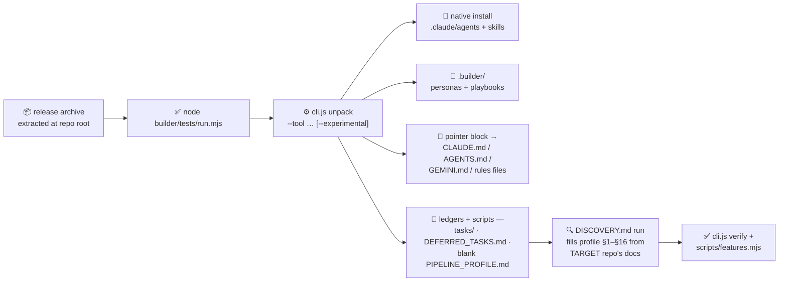

# 🔧 UNPACK — installing the builder kit into a project as a folder (secondary path)

> **Secondary.** The primary install is the npm package from a git tag — `npm i -D github:geopjinfo/builder-pipeline#<tag>`,
> then the one setup prompt ([`README.md`](README.md) § Getting started). This page is the folder-copy path: a release
> archive extracted as `builder/` and run as `node builder/cli.js <command>`, for a project without npm or a fetch.

<p align="center">
  
  
  
</p>



**With the folder in place,** `node builder/cli.js bootstrap` adds the `builder-init` skill; ask your agent to follow it
and it drives the inventory, your choices, `unpack`, discovery and `verify` with you confirming each step. What follows
is the underlying mechanics.

## Receive the pack

Take a **release archive**, not a working copy. The pack is versioned as its own git repository,
and a release is cut from its tag by whoever holds that repository:

```
git -C builder archive --format=zip --prefix=builder/ -o builder-<version>.zip v<version>
```

The archive contains no `.git`. **Never copy a working directory that contains `builder/.git`**
into a target repo. The target would gain a nested repository: its files invisible to the target's
own git, or committed as an unusable gitlink, and the pack's history would travel with it.

Extract the archive at the target repo root so that `builder/` sits there, with any zip tool. Then
prove the pack works before installing anything:

```
node --version
node builder/tests/run.mjs
```

The pack needs **Node 18 or newer**. The suite reads only its own fixtures, so it passes with no
project around it. A red suite means a damaged archive or an old Node: stop there.

**The normal manual path is the CLI** — from the target repo root:

```
node builder/cli.js unpack --tool <your-agent>
```

`<your-agent>` is one of claude-code, codex, gemini, cursor, copilot, windsurf, cline, aider,
opencode, generic — comma-separated, or `all`.

It places personas/skills for each chosen tool, wires a marker-guarded pointer block into that
tool's instruction file (`CLAUDE.md` / `AGENTS.md` / `GEMINI.md` / `.cursor/rules/` / …), installs
the ledgers, the scripts and a blank `PIPELINE_PROFILE.md`, and the optional utility skills
(`--no-extras` to skip). It never overwrites existing files (to take a newer release over an older
install, see [Upgrading an existing install](#upgrading-an-existing-install)); `--dry-run` previews every
destination; `verify` checks the result. Add **`--experimental`** only to install the experimental
items (the live page keeper and shell, among others). Each has its measurement in
[`EXPERIMENTS.md`](EXPERIMENTS.md), and installing one does not switch it on: its §16 state stays
`experimental-off` until someone sets it on purpose.

Then run the [`DISCOVERY.md`](DISCOVERY.md) prompt so the profile is filled from the **target**
project's own docs — the kit never imports its source project's rules.

The rest of this file is the manual/agent-driven equivalent, and the wiring detail the CLI can't
do for you (model tiers, hooks, judgement calls).

## Upgrading an existing install

Re-running `unpack` over an install from an older release is **not** an upgrade: copy-if-absent
adds the files that are new and keeps every file the new release *changed*, so new scripts end up
driven by old personas and old skills. Use `upgrade` instead. Extract the new release archive over
`builder/` (run `node builder/tests/run.mjs` on it), then from the target repo root:

```
node builder/cli.js --version
node builder/cli.js upgrade --tool <your-agent> --dry-run
node builder/cli.js upgrade --tool <your-agent>
```

Pass the same `--tool`, `--models`, `--no-extras` and `--experimental` you gave the original
`unpack` — `upgrade` walks unpack's own source→destination mapping, so it refreshes exactly the
files those flags install, and a different `--models` rewrites every persona's `model:` line.

| Owner | Files | What `upgrade` does |
|---|---|---|
| **Kit** | personas (`.claude/agents/` or `.builder/personas/`), skills + references, playbooks, hooks, `scripts/` + `scripts/lib/`, oracle adapters, experimental tooling, utility skills | overwrites a file whose content differs from the pack (line endings ignored), adds a missing one |
| **Project** | `PIPELINE_PROFILE.md`, the boards dir (incl. its `README.md` rules and session-board template), the registry, the decision log, the `specs/*.template.md` briefs, `.gitignore` | never touched once it exists; added only if missing — at its §16 `paths` location |
| **Shared** | the instruction file (`CLAUDE.md` / `AGENTS.md` / …) | only the text between `<!-- builder-kit:pipeline -->` and `<!-- /builder-kit:pipeline -->` is replaced, and only when it changed; everything around it stays byte-for-byte |

Blocks written before 0.14.0 have no end marker; `upgrade` recognises their fixed shape (heading,
one paragraph, one bullet list) and adds the end marker. A marked block it cannot recognise is left
as it is and reported `kept (by hand)`.

Every file it overwrites is first copied to `.builder/backup-<UTC stamp>/<same path>`. Each file
gets one line — `updated`, `added`, `unchanged` or `kept-project-owned` — then a summary.
`--dry-run` prints the same lines (`would be updated` / `would be added`) and writes nothing, not
even the backup directory.

Then:

1. Read `builder/CHANGELOG.md` from your old version up. Project-owned files are never rewritten,
   so a change to the board rules or the brief templates reaches you only if you diff them against
   `builder/templates/` yourself.
2. `node builder/cli.js verify`
3. `node builder/cli.js features` — a setting the new release added is off / `not configured` until
   §16 sets it.
4. Look over the diff, commit, and delete `.builder/backup-*` once satisfied (it is not ignored).

A kit-owned file you edited locally is overwritten too — its edit survives only in the backup.
Carry a local change in the profile, not in a persona (see *Customization guardrails* below).

## Step 0 — inventory the target repo (agent: do this first, read-only)

Detect and note (you will need these to fill the profile):

1. Stack: language, framework, ORM/DB, test runner, package manager.
2. Commands: build, test, lint, integration test, coverage, typecheck (from the package manifest's
   scripts, `Makefile`, `pyproject.toml`, CI config).
3. Module layout: where feature code lives; whether a template/reference module exists.
4. Existing catalogues that should be oracles (permission lists, error-code registries,
   state-machine specs, requirement trackers).
5. Paths that should be protected (core/platform layers, generated files, doc mirrors).
6. Existing conventions files (`CLAUDE.md`, `AGENTS.md`, `CONTRIBUTING.md`) — the profile must
   agree with them, not fight them.
7. Tools the optional features need, **present or absent**: an API contract file, a request/response
   transcript from a behavioural run, a knowledge-index tool, a syntax-tree rules runner, a mutation
   tool, a harness that keeps transcripts. Absent means the feature stays `off`.

## Step 1 — fill the profile (from the TARGET project's docs)

Copy `builder/PIPELINE_PROFILE.template.md` → repo root as `PIPELINE_PROFILE.md` (the CLI already
did this) and fill every section — the full procedure is [`DISCOVERY.md`](DISCOVERY.md): locate
*this* repo's docs/conventions/CI truth, fill each section with citations, mark undetectable
decisions `⚠ CONFIRM` for the human, and fill the §16 `pipeline-settings` block. Rules:

- **Interview the human for what you cannot detect** — oracles, protected paths, the human seam
  (§13), and the architecture stance are *decisions*, not discoveries. Present your best guess per
  section and ask for confirmation in one batch. If running non-interactively, fill best guesses,
  mark each with `⚠ CONFIRM`, and list them in your final report.
- **§16 switches a feature on only when the file or tool it needs exists in this repo.** Everything
  else stays `off`, and the run will say `not configured` for it.
- If the repo has no template module yet (§5), say so in the profile and note that the **first**
  module must be built human-led to *become* the template — the pipeline replicates; it does not
  design the golden path.
- Keep it under ~300 lines; link to specs, don't paste them.

## Step 2 — place the files (per harness)

`node builder/cli.js unpack --tool <t> --dry-run` prints every destination and wins over the lists
below if they ever differ.

### Claude Code

```
builder/agents/*.md            → .claude/agents/            (9 files — CLI transforms the neutral
                                                             capabilities/tier/effort frontmatter into
                                                             Claude Code tools/model/effort fields)
builder/skills/build-module-pipeline.md
                               → .claude/skills/build-module-pipeline/SKILL.md
builder/skills/references/*.md → .claude/skills/build-module-pipeline/references/
builder/skills/scaffold-module.md
                               → .claude/skills/scaffold-module/SKILL.md
builder/skills/module-readiness-check.md
                               → .claude/skills/module-readiness-check/SKILL.md
builder/templates/task-board.md → tasks/README.md           (create tasks/ dir)
builder/templates/deferred-registry.md → DEFERRED_TASKS.md  (repo root; keep header, empty table)
builder/templates/decision-log.md → DECISIONS.md            (repo root; keep header, empty index)
builder/templates/module-brief.md → specs/module-brief.template.md  (or wherever briefs live)
builder/templates/session-board.md
                               → tasks/_session-board.template.md  (cross-run delivery boards)
```

> **The four ledger destinations above are FIRST-INSTALL only.** Once `PIPELINE_PROFILE.md` exists,
> §16 `paths` — not this table — says where the boards, the registry and the decision log live, and
> the CLI installs them there. Copying to the defaults a second time adds a blank twin beside the
> real ledger that every checker reads §16 and passes over in silence, so the fallback scripts skip
> the ledgers when a profile is present, and `node builder/cli.js verify` fails on any that survive.

```
builder/scripts/*.mjs          → scripts/                   (board tooling + checkers)
builder/scripts/lib/*.cjs      → scripts/lib/               (the readers and checkers they share)
builder/oracles/               → beside the scripts          (contract-oracle adapters)
builder/hooks/claude-code/*.js → .claude/hooks/             (copied, NEVER registered by the CLI)
--experimental only:
builder/agents/experimental/page-keeper.md → .claude/agents/
builder/tooling/experimental/* → scripts/experimental/   (page-shell.cjs + page-shell.mjs)
```

The board scripts ship **with** the board rules deliberately: they turn the progress bar into a
projection of the Status column and fail the gate when it drifts. Without them the rule is
unenforceable, and a typed bar reports last week's number with this week's authority — the first
run of this pair in one adopting project found a board reading **0% while sitting at 8 of 12 done**.

`board-render.mjs` + `board-watch.mjs` add the half a markdown board cannot hold: what the run
*did*. The renderer joins the board to an append-only run log (`.pipeline/<key>/run.jsonl`) and to
the harness's own dispatch records, and writes one self-contained page — offline, no external
asset, reloading itself every 20 s. The watcher keeps it current, so a coder flipping a row to
`IN-PROGRESS` moves the page with no extra event. Start it once per run; see `tasks/README.md`.
A harness that keeps no dispatch records still gets everything except the accounting columns,
which render as em-dashes — never as zeroes.

The checker scripts ship for the same reason: a rule that says "cite accurately" or "write the
review in this shape" is only as good as the script that checks it. Each prints
`<feature>: not configured` when §16 has its feature off.

Then:
- Add `.pipeline/` and the `paths.logs` directory to `.gitignore`.
- Wire `node scripts/board-check-all.mjs` into the gate chain (profile §8).
- Adjust each agent's `model:` frontmatter to the profile §12 mapping (defaults are already sane).
- Add one line to the project's `CLAUDE.md`: *"Module builds go through the
  `build-module-pipeline` skill; project grounding is `PIPELINE_PROFILE.md`."*
- Merge the settings a person approves — spawn depth 1, and the hook entries for the features
  switched on — from [`adapters/claude-code.md`](adapters/claude-code.md) § Settings.
- Or run the mechanical copy: `builder/scripts/unpack.sh claude-code` (POSIX) /
  `builder/scripts/unpack.ps1 claude-code` (Windows), then do the bullet points above.
  Note: the script fallback copies personas **without** the frontmatter transform — they still
  work (harness defaults apply); prefer the CLI when Node is available.

### Codex (or any single-agent CLI without persona subagents)

See [`adapters/codex.md`](adapters/codex.md) for the full mapping. Summary:

```
builder/agents/     → .builder/personas/     (kept as prompt files, not auto-loaded)
builder/skills/     → .builder/playbooks/    (references/ included)
builder/templates/  → tasks/README.md, tasks/_session-board.template.md, DEFERRED_TASKS.md,
                      DECISIONS.md, specs/ as above — the ledger four at those DEFAULTS only on a
                      first install; §16 paths rules once a profile exists (see the note above)
builder/scripts/    → scripts/               (harness-independent; plain Node)
                    NOT materialised: qa-targets.md and requirement-pack.md are REFERENCES the
                    agent reads. The target config is written during setup step 6b (its format is
                    the project's choice); packs are authored per module during the qa-audit build.
```

- Add to `AGENTS.md`: *"Module builds follow `.builder/playbooks/build-module-pipeline.md`.
  Project grounding: `PIPELINE_PROFILE.md`. When the playbook says 'dispatch persona X', start a
  FRESH session whose first message is the persona file `.builder/personas/X.md` plus the
  distilled inputs the playbook specifies — never continue in the same context."*
- Phases become sequential fresh sessions (one child run per phase, or manual new chats). The
  orchestrator role is played by whichever session runs the playbook — or by the human. Parallel
  phase-4 auditors run as four concurrent child runs if available, else sequentially (order
  doesn't matter; they are independent).
- The adapter's last table says what each Claude-Code-only step becomes here.

### Generic (any capable agent)

See [`adapters/generic.md`](adapters/generic.md). The invariant that must survive any mapping:
**each phase runs with a fresh context whose system/first prompt is exactly one persona file +
`PIPELINE_PROFILE.md` + the distilled inputs** — and nothing else. If your harness can't isolate
contexts, at minimum start each phase with an explicit context reset and re-paste only the
persona + inputs.

## Step 3 — verify the install (agent: actually check these)

- [ ] `node builder/tests/run.mjs` is green.
- [ ] `PIPELINE_PROFILE.md` exists at repo root, every section filled or explicit `N/A`.
- [ ] `node builder/cli.js verify` passes — it also validates the §16 settings block.
- [ ] `node scripts/features.mjs` lists every feature, and each `on` feature's file or tool exists
      in this repo (no feature switched on to be filled in later).
- [ ] All 9 personas + the skills placed per the harness mapping; frontmatter `model:` matches §12.
- [ ] The board rules, the registry and the decision log exist at their §16 `paths`
      (`<boards>/README.md`, `<registry>`, `<decisions>`) and **nowhere else** — `verify` fails on a
      copy left behind at a default §16 moved; `.pipeline/` gitignored.
- [ ] `scripts/board-{progress,check-all}.mjs` installed and `board-check-all` wired into the gate
      chain — a computed bar nobody re-checks is back to being a typed claim.
- [ ] The harness conventions file (`CLAUDE.md` / `AGENTS.md`) points to the pipeline + profile.
- [ ] Oracles listed in profile §3 actually exist at their cited paths.
- [ ] A template module exists (profile §5) — or the profile records that it doesn't yet.
- [ ] Dry run: ask the planner persona to plan a tiny real module; confirm it writes
      `.pipeline/<key>/plan.md`, cites profile oracles, returns BLOCKERS honestly, and that
      `node scripts/output-check.mjs plan .pipeline/<key>/plan.md` accepts it.

## Step 4 — first run

1. Write a brief from `specs/module-brief.template.md` (fill every placeholder; delete
   inapplicable lines).
2. In a fresh session, say: *"Build the `<X>` module through the pipeline."*
3. Expect the pipeline to stop and ask on: missing oracle entries, boundary events, spec gaps.
   That's the mechanism working — rule on them and resume.

From here on, [`USAGE.md`](USAGE.md) is the operating manual (stop points, record points,
resumption, troubleshooting).

## Customization guardrails (for the tuning agent)

- Change the **profile** freely; change **personas** only to remove a section that genuinely
  cannot apply (and say so in your report). Never remove: the five-clause operating contract, the
  output contract, read-only restrictions, or the "stop and ask" boundary rule.
- `DESIGN.md` lists what may be scaled down (merging the auditors; skipping docs) and what
  may not (coder ≠ reviewer; the board; loop-back; close-out DONE audit).
- Do not localize the kit by pasting project rules *into* personas — that recreates the
  maintenance problem the profile exists to solve. Personas cite the profile; the profile cites
  the specs.
- Switch features off in §16 rather than deleting the steps that ask for them: an off feature
  says `not configured`, while a deleted step leaves no trace that anything was skipped.
