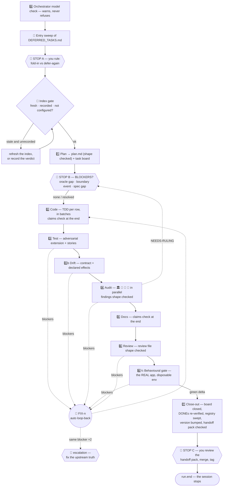
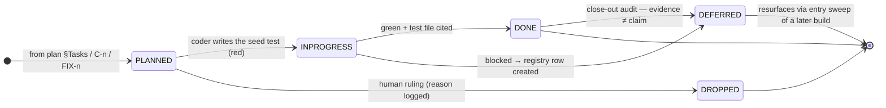

# 🕹️ USAGE — running builds day to day (the human operator's runbook)

<p align="center">
  
  
  
</p>

Setup done (`unpack` → `DISCOVERY` → `verify` all green)? This is what operating the pipeline
looks like from your side of the desk. The agent-facing mechanics live in the installed
`build-module-pipeline` skill; this page is your view: what to say, what happens, where the
pipeline **stops and waits for you**, what it **records** along the way, and what to do at each
point.

> **Commands.** Written for the npm-package install: `npx builder <command>`, and a kit script as
> `npx builder run <name>`. With the kit copied in as a `builder/` folder instead ([`UNPACK.md`](UNPACK.md)),
> run the CLI through `builder/cli.js` with Node, and a kit script from the project's `scripts/` copy.

## Running one module build

### 1. Write the brief (5–15 minutes, the highest-leverage step)

Copy `specs/module-brief.template.md` → `specs/briefs/<moduleKey>.md` and fill it. Delete lines
that don't apply. The lines people skip are exactly where escaped defects come from — the
boundary decision (§2), exact catalogue keys (§4), and the access-scope shape (§5) deserve real
thought. If you can't answer a section, that's a finding in itself: answer it before the build,
not during.

### 2. Start it — in a fresh session

> Build the `<moduleKey>` module through the pipeline. Brief: `specs/briefs/<moduleKey>.md`.

That's the whole incantation. (Claude Code: the skill triggers on this phrasing. Codex/other:
open the playbook per your tool's pointer block — it walks the same steps.) **One run per
session**: start each build in a new session, and do not reuse the session afterwards.

### 3. What you'll see happen



Watch progress any time by opening `tasks/<moduleKey>.md` — it's the live, git-tracked truth and
the one progress surface. `.pipeline/<moduleKey>/plan.md` and `review.md` are the run's full audit
trail.

Every board row lives this lifecycle:



## The stop points — where the pipeline waits for YOU

**A. Deferred candidates (entry).** The pipeline lists registry rows this module might unblock
and asks fold-in or defer-again per row. Rule each explicitly — there is deliberately no silent
auto-folding. A fold-in becomes a planned board row; a defer-again is recorded with your ruling.

**B. BLOCKERS (after planning, or any time).** Only `BLOCKING`-class items stop the run — a gap the
docs already settle is decided and recorded, and a `NEEDS-RULING` item proceeds on a stated
assumption while it waits for you. Three kinds reach you, all meaning "a human decision is missing,
not an agent failure":
- *Missing catalogue entry* (permission key, error code, state name) → add it to the oracle
  yourself, or reject the need; then say "resume".
- *Boundary event* (the design needs a protected-path edit) → grant an explicit unlock for this
  build (and revert it after merge), or redirect the design. Never let the agent work around it.
- *Spec gap/contradiction* → resolve the spec, then resume. If the agent guessed instead of
  stopping, that's a bug in your profile wording — tighten it.
- *`NEEDS-RULING` from the invariant auditor* → a coherence case the project has no rule for, with
  the observed behaviour attached. **It is not a defect and not a pass.** Rule it; do not let anyone
  "fix" it first, because fixing it *is* ruling it.

**C. MERGE-READY handoff (the end).** The pipeline never merges, pushes, or opens PRs. You get a
summary, the requirement-traceability result, and **the handoff pack**: one file for the run under
`paths.handoffs`, with §A progress · §B tracker flips (when a tracker is configured) · §C decisions ·
§D registry changes · §E docs owed · §F merge conditions. Each item carries a `RESPONSE REQUIRED`
line. Your close-out: run the gates + full integration tier yourself, review the diff, merge, tag,
answer the pack, revert any unlock — and check every ruling you made during the run has its row in
`DECISIONS.md`.

**Unscheduled stop — two-strike escalation.** If the same blocker survives two fix loops the
pipeline stops and tells you. This almost always means the plan or a spec is wrong, not the code.
Read the blocker, fix the upstream truth (profile, oracle, spec, brief), then resume.

## The record points — what the pipeline checks and writes on its own

None of these wait for you unless they fail. Each is a script, and each prints
`<feature>: not configured` when §16 has it off.

| When | Command | What it means |
|---|---|---|
| P0 | `npx builder run orchestrator-check` | The session's model vs `models.orchestrator`. Exit 5 is a **warning**, never a refusal; no readable transcript is *unmeasured*, not a pass |
| P1, before the planner | `npx builder run index-check` | Knowledge-index freshness. `0` fresh · `3` absent · `4` unmeasurable · `10` docs pending · `11` code behind · `12` both. With `features.graph` on, a non-zero exit that is not recorded in the run's state file **refuses the planner**: refresh (code refresh is free; doc embedding spends tokens, and above the automatic limit a person decides) or record the verdict. With it off: `graph: not configured`, and the run goes on |
| P1 · P4 · P6 | `npx builder run output-check plan\|findings\|review <file>` | The plan, each findings block and the review have their fixed shape; a malformed one goes back to its seat |
| End of P2 and P5 | `npx builder run claims-check --run <key>` | Every recorded count re-run, every `file:line` still points at its content, no retracted phrase, every owed note resolves |
| P7 | `npx builder run handoff-pack <key>` then `npx builder run handoff-check <file>` | The handoff pack is generated from the board, run log and registry, then checked. **Close-out cannot finish on a failing pack** |
| After P7 | — | `run.end` is logged and the session stops. Follow-up work takes a new key, board and session |

## Interruptions and resumption

State lives in files, not in the agent's head — so resumption is cheap. If a session dies or you
stop it: the board shows exactly which rows are DONE (with test evidence) and which aren't.
Restart in a fresh session with:

> Resume the `<moduleKey>` pipeline build. Board: `tasks/<moduleKey>.md`,
> plan: `.pipeline/<moduleKey>/plan.md`. Continue from the first non-DONE row.

If `.pipeline/` was lost (it's gitignored), re-run Phase 1 — the planner regenerates the plan
from the same sources; the board keeps the completed rows.

## Smaller than a module?

For a fix or small feature that doesn't warrant the full phase list, use the FIX or SOLO track
(phase 0.5) — or the pieces directly:
- `scaffold-module` skill — just the golden-path scaffold.
- `module-builder` persona standalone — it then self-runs `module-readiness-check` +
  `standards-auditor` (its file tells it to).
- `module-readiness-check` — pre-PR bar on anything, any time.
- `ledger-audit` (extras) — periodic "are our DONEs real" sweep; schedule it, drift compounds
  silently between audits.

## Removing a tool, or the kit (`uninstall`)

```
npx builder uninstall --tool codex --dry-run   # what would go
npx builder uninstall --tool codex             # drop one tool
npx builder uninstall --all                    # drop the kit
```

It removes only what `builder.lock.json` says the kit wrote, and only files whose bytes still match the lock (each is
backed up under `.builder/backup-<stamp>/` first). A file you edited since is kept and named. A file several tools
share stays while one of them is still installed. The pointer block comes out of each instruction file (or is
re-wired for the tools left), and your text around it stays. `PIPELINE_PROFILE.md`, the ledgers, `builder.choices.json`
and the `.gitignore` lines are never touched. `--all` also removes the vendored hook scripts (`.claude/hooks/kit/`),
any kit-locked `scripts/` copies and, once nothing is left to record, the lock. Uninstalled with npm too? Remove the
dependency afterwards (`npm uninstall @geopjinfo/builder-pipeline`).

## Troubleshooting

| Symptom | Likely cause | Fix |
|---|---|---|
| `verify` fails on placeholders | profile never filled / half-filled | run the kit's `DISCOVERY.md` prompt; answer the `⚠ CONFIRM` batch |
| `verify` reports a §16 error, or a script refuses to start with a settings error | the `pipeline-settings` block is invalid: JSON syntax, more than one block, a feature `on` with a required key empty, an unknown feature name (usually a typo), a `<placeholder>` left in, `commands.tier` without `{tier}` | fix the path the error names. Never set a feature `on` to silence an error, and never delete the block — with no block every optional feature is off |
| A run prints `<feature>: not configured` | that feature's state is `off` in §16 — the default for anything the project was not shown to have | expected if the project lacks the file or tool. To switch it on: install what it needs, set `state: "on"`, fill its required keys, run `npx builder verify`, then `npx builder run features` |
| Planner not dispatched at P1 | the index gate saw a stale index and no recorded verdict | run the free code refresh; embed pending docs if within the limit (or decide, if above it); or record the verdict in the state file's `Graph:` line |
| `orchestrator-check` exits 5 | the session was started on a different model from `models.orchestrator` | restart the session on the declared model, or proceed and note it — it is a cost and capability choice, not a correctness gate |
| Claims check fails at the end of P2 or P5 | a stale count, a citation whose line moved, a retracted phrase, an owed note naming nothing | fix the record. Never widen the checker to pass a false record |
| Handoff check refuses close-out | a section missing, an item without `RESPONSE REQUIRED`, a fill marker left, a cited id that does not exist | complete the pack; the check names each gap |
| The pack is out of date (a newer release, or the installed files lag the kit's `CHANGELOG.md`) | `unpack` copies only absent files, so an upgrade never overwrites installed ones | bump the dependency tag, run `npx builder upgrade --tool <your tools>` (it refreshes kit-owned files after a backup and keeps your local edits), read the CHANGELOG entries since your old version, then `npx builder verify` |
| Cost figures look wrong against the bill | the rate table is stale, or accounting is off / unavailable in this harness | compare `scripts/lib/pricing.cjs` and its version with the published rates; update the table and its version together. Em-dashes mean unmeasured, not free |
| `pack tests: Node …` | Node older than 18 | upgrade Node; the pack's scripts and tests need 18 or newer |
| Agent invents a permission key / state name | oracle path in profile §3 wrong, or oracle not listed | fix §3; the persona rule only bites if the oracle is findable |
| Personas don't load (Claude Code) | files not under `.claude/agents/` (unpack run from wrong dir) | re-run `npx builder unpack` from repo root; check `verify` |
| Other tools ignore the pipeline | pointer block missing from that tool's instruction file | re-run unpack for that `--tool`; check the file for the `builder-kit:pipeline` marker |
| Coder edits a protected path | harness has no hook enforcement | add one (see `hooks/README.md`); meanwhile reject the diff and re-dispatch |
| A hook registered today does nothing | harness hooks and settings are read at session start | start a new session |
| Board rows DONE without test evidence | persona rules being paraphrased/trimmed | restore verbatim persona files; that rule is load-bearing (DESIGN §7). `npx builder check-ledgers` catches it mechanically — wire it into CI |
| `npx builder check-targets` fails | safety gate for the `qa-audit` skill: a target whose DATASTORE is shared is marked destructive, an attach target does not declare `shared`, or a credential is embedded in the config | fix the config. Run it in CI — the rule must not depend on someone reading a doc |
| Ledger drift (dangling `DEFERRED→id`, odd statuses) | hand-edited boards/registry | `npx builder check-ledgers` — 5 gates (LG-1…LG-5), exits non-zero for CI |
| Board shows a percentage nobody believes | the bar was typed, not computed | `npx builder run board-check-all` (`--fix` to rewrite). Wire it into the gate chain — a bar looks like an output even when it is an input, which is how one board sat at "0%" with 8 of 12 rows done |
| Pipeline "finishes" but reviewer never ran | orchestrator drifted from the playbook | ask for the review file's verdict; no verdict = not done, re-run Phase 6 |
| Same blocker loops forever | upstream truth wrong (spec/brief/plan) | that's what two-strike escalation is for — fix the doc, not the code |

## Cost & pacing expectations

One module is a dozen or more agent dispatches: the planner, the builder in batches of at most
`features.builderBatch.rows` rows, the tester, four auditors, docs and the reviewer, plus
loop-backs. Strong-model phases dominate cost; profile §12 is where you trade cost vs. rigor. Where
the harness keeps transcripts and `features.costAccounting` is on, the board shows measured spend
per seat. `npx builder run cost-window` and `npx builder run seat-peaks` compare runs before and
after a change. Judge any setting change over several runs, never one. Scaling guidance — what may
be merged or skipped and what never — is in `DESIGN.md` §"Tuning".
