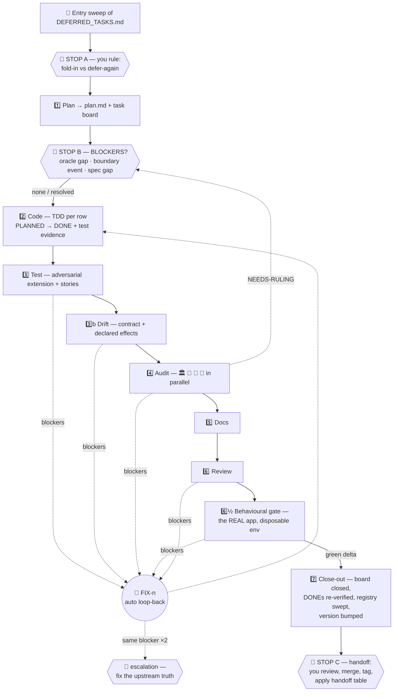
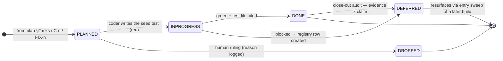

# 🕹️ USAGE — running builds day to day (the human operator's runbook)

  
  
  

Setup done (`unpack` → `DISCOVERY` → `verify` all green)? This is what operating the pipeline
looks like from your side of the desk. The agent-facing mechanics live in the installed
`build-module-pipeline` skill; this page is your view: what to say, what happens, where the
pipeline **stops and waits for you**, and what to do at each stop.

## Running one module build

### 1. Write the brief (5–15 minutes, the highest-leverage step)

Copy `specs/module-brief.template.md` → `specs/briefs/<moduleKey>.md` and fill it. Delete lines
that don't apply. The lines people skip are exactly where escaped defects come from — the
boundary decision (§2), exact catalogue keys (§4), and the access-scope shape (§5) deserve real
thought. If you can't answer a section, that's a finding in itself: answer it before the build,
not during.

### 2. Start it

> Build the `<moduleKey>` module through the pipeline. Brief: `specs/briefs/<moduleKey>.md`.

That's the whole incantation. (Claude Code: the skill triggers on this phrasing. Codex/other:
open the playbook per your tool's pointer block — it walks the same steps.)

### 3. What you'll see happen

Watch progress any time by opening `tasks/<moduleKey>.md` — it's the live, git-tracked truth.
`.pipeline/<moduleKey>/plan.md` and `review.md` are the run's full audit trail.

Every board row lives this lifecycle:

## The stop points — where the pipeline waits for YOU

**A. Deferred candidates (entry).** The pipeline lists registry rows this module might unblock
and asks fold-in or defer-again per row. Rule each explicitly — there is deliberately no silent
auto-folding. A fold-in becomes a planned board row; a defer-again is recorded with your ruling.

**B. BLOCKERS (after planning, or any time).** Only `BLOCKING`-class items stop the run — a gap the
docs already settle is decided and recorded, and a `NEEDS-RULING` item proceeds on a stated
assumption while it waits for you. Three kinds reach you, all meaning "a human decision is missing,
not an agent failure":
- *Missing catalogue entry* (permission key, error code, state name) → add it to the oracle
  yourself, or reject the need; then say "resume".
- *Boundary event* (the design needs a protected-path edit) → grant an explicit unlock for this
  build (and revert it after merge), or redirect the design. Never let the agent work around it.
- *Spec gap/contradiction* → resolve the spec, then resume. If the agent guessed instead of
  stopping, that's a bug in your profile wording — tighten it.
- *`NEEDS-RULING` from the invariant auditor* → a coherence case the project has no rule for, with
  the observed behaviour attached. **It is not a defect and not a pass.** Rule it; do not let anyone
  "fix" it first, because fixing it *is* ruling it.

**C. MERGE-READY handoff (the end).** The pipeline never merges, pushes, or opens PRs. You get:
a summary, the requirement-traceability result, and the **handoff table** — every change only a
human may apply (tracker status flips, protected-doc edits, catalogue amendments, any warranted
ADR). Your close-out: run the gates + full integration tier yourself, review the diff, merge,
tag, apply the handoff table, revert any unlock — and check every ruling you made during the run
has its row in `DECISIONS.md` (the pipeline logs them at its close-out; spot-check).

**Unscheduled stop — two-strike escalation.** If the same blocker survives two fix loops the
pipeline stops and tells you. This almost always means the plan or a spec is wrong, not the code.
Read the blocker, fix the upstream truth (profile, oracle, spec, brief), then resume.

## Interruptions and resumption

State lives in files, not in the agent's head — so resumption is cheap. If a session dies or you
stop it: the board shows exactly which rows are DONE (with test evidence) and which aren't.
Restart with:

> Resume the `<moduleKey>` pipeline build. Board: `tasks/<moduleKey>.md`,
> plan: `.pipeline/<moduleKey>/plan.md`. Continue from the first non-DONE row.

If `.pipeline/` was lost (it's gitignored), re-run Phase 1 — the planner regenerates the plan
from the same sources; the board keeps the completed rows.

## Smaller than a module?

For a fix or small feature that doesn't warrant the full phase list, use the FIX or SOLO track
(phase 0.5) — or the pieces directly:
- `scaffold-module` skill — just the golden-path scaffold.
- `module-builder` persona standalone — it then self-runs `module-readiness-check` +
  `standards-auditor` (its file tells it to).
- `module-readiness-check` — pre-PR bar on anything, any time.
- `ledger-audit` (extras) — periodic "are our DONEs real" sweep; schedule it, drift compounds
  silently between audits.

## Troubleshooting

| Symptom | Likely cause | Fix |
|---|---|---|
| `verify` fails on placeholders | profile never filled / half-filled | run `builder/DISCOVERY.md` prompt; answer the `⚠ CONFIRM` batch |
| Agent invents a permission key / state name | oracle path in profile §3 wrong, or oracle not listed | fix §3; the persona rule only bites if the oracle is findable |
| Personas don't load (Claude Code) | files not under `.claude/agents/` (unpack run from wrong dir) | re-run `node builder/cli.js unpack` from repo root; check `verify` |
| Other tools ignore the pipeline | pointer block missing from that tool's instruction file | re-run unpack for that `--tool`; check the file for the `builder-kit:pipeline` marker |
| Coder edits a protected path | harness has no hook enforcement | add one (see `adapters/claude-code.md` hardening note); meanwhile reject the diff and re-dispatch |
| Board rows DONE without test evidence | persona rules being paraphrased/trimmed | restore verbatim persona files; that rule is load-bearing (DESIGN §7). `node builder/cli.js check-ledgers` catches it mechanically — wire it into CI |
| `node builder/cli.js check-targets` | Safety gate for the `qa-audit` skill: fails if a target whose DATASTORE is shared is marked destructive, if an attach target does not declare `shared`, or if a credential is embedded in the config. Run it in CI — the rule must not depend on someone reading a doc. |
| Ledger drift (dangling `DEFERRED→id`, odd statuses) | hand-edited boards/registry | `node builder/cli.js check-ledgers` — 5 gates (LG-1…LG-5), exits non-zero for CI |
| Board shows a percentage nobody believes | the bar was typed, not computed | `node scripts/board-check-all.mjs` (`--fix` to rewrite). Wire it into the gate chain — a bar looks like an output even when it is an input, which is how one board sat at "0%" with 8 of 12 rows done |
| Pipeline "finishes" but reviewer never ran | orchestrator drifted from the playbook | ask for the `review.md` verdict; no verdict = not done, re-run Phase 6 |
| Same blocker loops forever | upstream truth wrong (spec/brief/plan) | that's what two-strike escalation is for — fix the doc, not the code |

## Cost & pacing expectations

One module = 8–12 agent dispatches (more with loop-backs). Strong-model phases (plan, code,
audits, review) dominate cost; profile §12 is where you trade cost vs. rigor. Scaling guidance —
what may be merged or skipped and what never — is in `DESIGN.md` §"Tuning".
