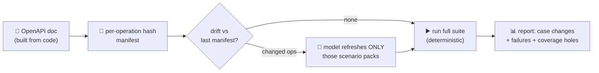

# E2E harness — OpenAPI-driven, drift-gated, deterministic-first

The pattern (taken from one production harness of several hundred tests): the **API contract is the test oracle**.
Every operation in the OpenAPI document gets a scenario pack; a **drift gate** hashes the
contract so CI knows exactly which operations changed; the model regenerates **only the delta** —
detection, execution, and reporting are deterministic and cost zero tokens.

## Phase A — build it (once; ~the pipeline can build this as a module-sized task)

1. **Contract source.** The OpenAPI document must be generated from code (routes/schemas), never
   hand-written — otherwise the harness tests the doc, not the app. If the project has no
   contract, STOP: adopting one is a human decision (profile §3 oracle candidate).
2. **Scenario packs.** One pack per operation (`test/e2e/packs/<operationId>.*`), covering:
   happy path · auth matrix (each role from profile §6 AuthZ, expect allow/deny per grants) ·
   validation rejection (unknown field, bad types) · error contract (exact codes/envelope from
   profile §6) · side-effect assertions for mutators (row exists/changed, audit entry, event
   emitted) — a 2xx alone proves routing, not behaviour.
3. **Drift gate.** A manifest file mapping `operationId → hash(method, path, params, schemas,
   authZ key)`. A CI step diffs it against the committed manifest: changed/added ops with
   unchanged packs = **drift failure** (regenerate before merge); removed ops = orphan packs.
4. **Real infrastructure.** Containers (DB, cache) — never mocks; seed idempotently; each pack
   isolated (own tenant/prefix) so the suite parallelizes.
5. **Determinism budget.** Everything except pack *generation* runs without a model: the runner,
   the drift diff, the report. Keep it that way — it's what makes the harness cheap to run on
   every commit.

## Phase B — operate it (every API change)

1. Rebuild the OpenAPI doc → run the drift gate.
2. No drift → run suite → report. Done.
3. Drift → for each changed operation: re-read its route/schema/permission **from code**,
   regenerate that pack only (keep the pack's manual additions — marked blocks survive), rerun.
4. Report: packs changed (with why), pass/fail, and **coverage holes** — operations whose pack
   lacks an auth-matrix or side-effect case (list them; don't silently accept breadth-only).

## Rules

- The suite is **breadth** insurance — it complements, never replaces, the pipeline's per-module
  depth tests (tester tiers, profile §9).
- A drift-gate failure is a **merge blocker**, same class as a failing unit test.
- Positive-control rule applies to packs too (an expected-empty list needs a seeded-nonempty
  control).
- Wire commands into profile §2 once built (`test:e2e`, `test:e2e:drift`). An agent runs the suite
  through the tier wrapper (`commands.tier` with `{tier}` = the e2e tier), never bare: the wrapper
  keeps the full log on disk and prints a short digest.
