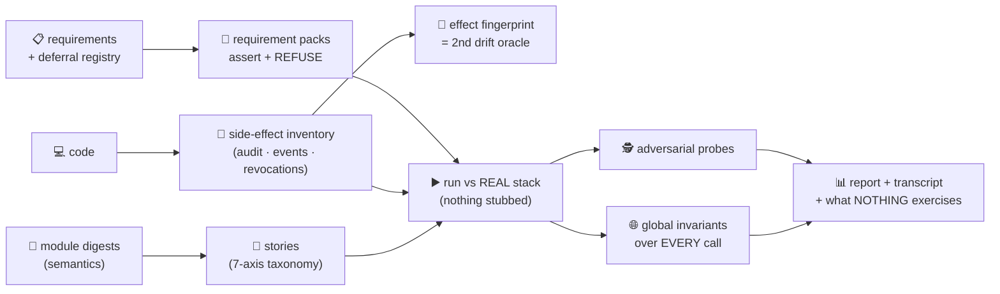

# QA audit — the real app, real infra, requirements as the oracle

The e2e harness asks *"does the API behave consistently with its contract?"* This asks the three
questions a contract can never answer: **"does it do what the business asked, and refuse what the
business forbade?"**, **"did every transition actually cause what it claims to cause?"**, and —
the one almost every suite misses — **"is the system still coherent afterwards?"**

Proven on a 17-module production backend: 1 200+ assertions over real HTTP, a 4 800-call
transcript, and findings a green suite had been hiding — **53 of 81 declared audit actions fired
in no scenario at all**, and later, **51 invariant findings (31 confirmed live) against a suite
that was fully green**. A green run is not a covered run, and a covered run is not a sound system.

Everything project-specific — requirement source, what counts as an effect, environments,
redaction fields, error-shape conventions, artifact paths — lives in **profile §14**, never in this
skill. Start from `templates/qa-targets.md`, `templates/requirement-pack.md`,
`templates/module-digest.md`, `templates/invariant-registry.md` and `templates/story-pack.md`.

## The ceiling that makes Phase C necessary

Phases A1–A7 all derive their scenarios from a **declaration**: a requirement row, a permission
matrix, a state machine, an effect inventory. That is a structural ceiling, not an oversight — **no
derivation can reach a case no declaration mentions.**

Two escapes make it concrete, and both are cheap to reproduce in any codebase:

- **An administrator deactivated his own account.** Permission held, target existed, transition
  legal — a correct `200` by every declared measure. No requirement anywhere says "an actor must
  not remove their own access", so no derived scenario could exist.
- **A duplicate unique field returned `500`.** Every gate passed because the pack asserted
  `!is2xx(status)` — which a `500` satisfies exactly as well as a `422`. The refusal was asserted
  by *absence of success*, never by *shape*.

Phase C exists for that class. Build A and B first; C is worthless without a working transport.

## Phase A — build it

1. **Transport seam first.** One request interface, two implementations: in-process (fast, CI) and
   over-the-wire (real). Every scenario runs **unmodified** on both — a result that differs between
   tiers is itself a finding. Build this before anything else or you will fork your suite.
2. **A disposable environment.** Unique project namespace, shifted ports, volumes destroyed on
   teardown. The audit locks accounts, revokes grants and hard-deletes; that is only acceptable
   where nobody else is looking. **Shift EVERY published port**, not most — one unshifted port
   collides with a developer's running stack and takes down the whole bring-up, not just that
   container.
3. **Side-effect inventory, extracted from code** — every audit-write, event publish, session
   revocation, version-guarded write, and which storage each module writes. Hash it per module:
   that is a **second drift oracle** catching what a contract hash cannot, because a transition
   that silently stops auditing changes no route, no schema, no permission.
   **Watch for dynamically-named effects.** An action composed at runtime (`` `audit.${kind}` ``)
   is invisible to a static extractor, so the oracle is blind exactly where the name is built. Name
   those in the report rather than letting them read as "no effects".
4. **Requirement packs**, authored REQ-first (never endpoint-first), with a four-verb vocabulary —
   this is the part everything else depends on:

   | verb | when | why it matters |
   |---|---|---|
   | `assert` | the requirement, as written | the baseline |
   | `by-design` | text and intent diverge — **cite the ruling** | a documented deferral asserted as a requirement produces a **false defect** |
   | `gap` | genuinely unenforced, known | records without failing; keeps it visible |
   | `skipped` | could not run | a silent skip is how a control goes unaudited for a year |

5. **Adversarial probes** — permission mirror (what the UI is told vs what the server enforces) ·
   CSRF/token abuse (forged, cross-wired, **reused after logout**) · optimistic-lock sweep across
   every write route · illegal state transitions · **effect coverage**.
6. **Call transcript** — every request/response with headers, bodies, timing, attempts, grouped by
   story. Pure plumbing, zero model cost. **Redact secrets to a short correlating prefix**: enough
   to see two calls shared a session, never enough to reuse one.
7. **Doc grounding — the join that makes the gap actionable.** Per module, join four sources:
   declared transitions (from code) × requirements (from profile §14) × published routes ×
   the effect inventory. That yields the **worklist**: every declared effect nothing exercises,
   named, with the routes that reach it. Without this you get a number ("53 unexercised"); with
   it you get work. Watch for more than one way to declare a transition — a state machine
   registry AND a policy map is common, and reading only one under-reports badly.

## Phase C — the layer declarations cannot reach

Each of these is independently useful; build them in this order, because each is cheaper and more
mechanical than the next.

8. **Global invariants over the transcript** *(deterministic, free, biggest first win)*. A post-pass
   over **every call the run made for any purpose** — not the calls a test aimed at. Assert only
   what must hold everywhere:
   - nothing answers 5xx (the difference between *refused* and *crashed*);
   - every 4xx carries your house error shape and code — this is the general form of the
     duplicate-field `500`, and it closes the whole class rather than one field at a time;
   - no response body leaks a password hash, a stack frame, or a session token.

   It needs no new requests, spends no model budget, and works on read-only targets. An invariant
   that cannot be evaluated from the transcript reports `not-evaluable` — **never** a pass.

9. **An invariant registry, and the discipline that makes it honest.** Reflexive and system-safety
   cases (`templates/invariant-registry.md`): actor targets themself · removing the **last** of
   something that cannot be recreated · a live token after its subject dies.

   **The auditor observes; it never rules.** Each entry is `ruled` (a ratified source says what must
   happen → assert it) or `unruled` (nothing says → record the observed behaviour as `NEEDS-RULING`
   and generate a ruling request for a human). Inventing the expectation would make the audit the
   author of the requirement it is auditing, and a later reader could not tell a ratified rule from
   a test-writer's opinion. Yes, this leaves a real hazard sitting as `NEEDS-RULING` until someone
   rules — that is correct, because it is *visible* either way.

10. **A hostile-input battery**, generated from your API schema: malformed envelopes, boundary and
    unicode/RTL scalars, prototype-pollution keys, garbage concurrency headers, absurd pagination,
    identifiers from the wrong module. Assert **only** that a refusal is shaped and never a crash —
    no business outcome. That restriction is what keeps it pure generator code with no per-module
    authoring, so it covers every module you ever add, automatically.

11. **Module digests → stories.** A digest is the semantic model of one bounded context
    (`templates/module-digest.md`): aggregates and lifecycles, which routes can have **caller ==
    target**, what the module assumes of its neighbours, and a list of **invariant candidates**.
    Stories (`templates/story-pack.md`) turn its OPEN candidates into scenarios across a fixed
    7-axis taxonomy — wrong-actor · wrong-time · reflexive · lifecycle · interleaving ·
    cross-module · identity-abuse. The taxonomy is the completeness guard: authoring becomes a
    sweep rather than inspiration.

12. **A seeded monkey walk** *(opt-in, destructive targets only)*. Random (actor, operation,
    argument) selection, asserting **only** the invariants from step 8 — it has no model of any
    endpoint, so any business assertion it made would be invented.
    - **Seeded**, from one integer. Replay is the entire value of a random walk; a finding nobody
      can reproduce is folklore.
    - **Stateful** — harvest identifiers from responses and feed them into later requests, or the
      walk spends its whole budget re-testing the 404 path.

## Phase B — operate it

1. **Ask which environment.** Config-driven targets, never hardcoded; read connection details from
   whatever files your deployment tooling already generates, so the audit cannot drift from how the
   environment was provisioned.
2. **Both drift oracles first** (free). Contract drift → do not re-baseline to go green; that marks
   untested operations as accounted-for. Effect drift → read the REMOVED lines first.
3. **Run, report, file.** The report carries, in this order: a **per-requirement matrix** (id →
   assertions, failures, whether it contains by-design/gap/skipped rows) · a **per-module effect
   matrix** (declared vs exercised) · the authz/controls verdict · the **global-invariant** verdict
   · every **NEEDS-RULING** observation · **the worklist** · and coverage that NAMES what it did not
   touch rather than counting it. Durable findings go to the deferral registry; the report is dated
   and never overwritten — the history is the trend record.
4. **Work two backlogs.** The unexercised-effect list *and* the OPEN invariant candidates. Neither
   is the pass count.

## Rules

- **Whose DATA is it, not whose process.** A local app pointed at a shared database is a SHARED
  target. Read-only must be **enforced in code** — mutating phases refused, reduced coverage stated
  in the report — not left to discipline. Judge each capability by the same test: resetting a rate
  limiter is fine on *your* store and never on the team's.
- **Absent evidence is never a pass.** No data ⇒ `UNKNOWN`, never 100%. (A reporting bug that
  printed full coverage while holding zero evidence is the worst defect this pattern produced.)
- **An observer that cannot observe must THROW, not return empty.** A store probe that swallows its
  connection error and returns "not found" makes every NEGATED assertion over it pass while
  observing nothing. That blindness hid a critical session-revocation defect behind 1 221 green
  assertions. **A negated assertion over an unobservable value is not a test.**
- **When a probe asserts absence, prove it could have observed presence.** Give every
  refusal-based check a positive control — the actor completes an ordinary action first, or the
  grant is asserted live before it is revoked. Twice this pattern produced a *phantom guard*: a
  refusal that looked exactly like the protection being tested for, but came from an unrelated gate
  or from the probe's own malformed request. Treat a validation error naming a field the probe
  never sent as **inconclusive**, never as evidence.
- **Split generated facts from authored judgement.** In a digest, keep derivable facts (transitions,
  routes, requirement rows) **regenerated** from the repo below a marker, and freeze only the
  judgement above it. A hand-copied fact rots the first time the code moves, and a trusted-but-wrong
  document is worse than none. Gate staleness mechanically.
- **Never claim "covered" without naming what covers it.** An uncited `covered` is an unfalsifiable
  claim and exactly how unearned status breeds.
- **Ban assert-by-absence-of-success in story files** (`!is2xx` and friends), mechanically. That
  idiom is how the duplicate-field `500` passed every gate. Assert an exact status and code, or
  record the observation.
- **No silent caps.** Anything bounded says what it dropped and why.
- **Probes run last** — they revoke tokens and forge headers; anything after them measures the
  probe's wake. A monkey walk runs after those.
- **A pack must never poison a shared fixture.** Snapshot and restore, or use a throwaway. An
  admin password-reset can make a seeded persona permanently unloginable and every later scenario
  will look broken.
- **A pack must not assume an empty database.** Ephemeral targets make that assumption true and hide
  every violation of it; the first run against a persistent one fails in ways that look like product
  defects. Salt fixtures **per run**, assert on rows **you created**, derive dates from current
  state, and never create a row your API cannot delete.
- Expect **most early findings to be in the harness, not the product** — that is the tier working,
  and worth reporting honestly rather than dressing up as product defects.

## The honesty boundary

Every layer here answers *"may role X call route Y, and does it return the right code?"* — and
Phase C widens that to "and is the result coherent?" for the cases you thought to encode. **Neither
proves the system is sound.** Business invariants and infrastructure posture (an unauthenticated
cache, an unpartitioned audit table, a credential that outlives its owner) are not reachable from a
route inventory.

So when a run is green, say **"every declared behaviour held"**. Never "the system is sound".
