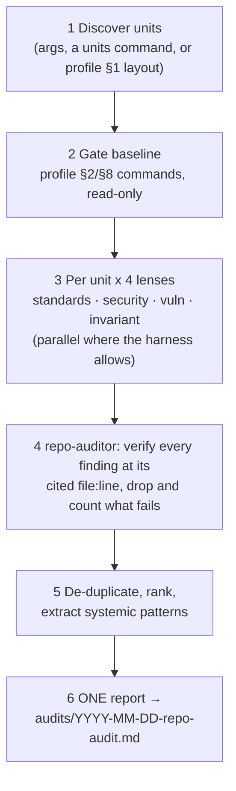

# Repo-audit — whole-repo fan-out through the kit's auditor lenses

Read-only. Reuses the four installed auditor personas (`standards-auditor`, `security-auditor`,
`vuln-auditor`, `invariant-auditor`) — the same lenses that gate every module build, now swept
across **every** unit at once — plus a synthesis seat, `repo-auditor`, that does what a per-module
gate can't: verify every finding at its `file:line`, de-duplicate across units, and extract
**systemic patterns** (a defect in N units is one finding with N locations, and its fix is a
template/profile fix, not N patches).

## Before anything: opt-in and scope

The sweep spawns one seat per unit per lens plus the gate run — it is token-heavy. **Confirm with the
human before starting** unless they already said run, and offer the cheaper scopes first when the
scope is unclear: a unit subset, a lens subset, or `since <ref>` (each lens audits only the diff).

## Without a profile

The project has not adopted the pipeline, so there is no §1 layout, §2 gate list or §16 to read. Take the units
and gates from `args` or from the person, and add the kit tools on named targets to the baseline; each runs with
the default settings and says so on its first line: `npx --no-install builder-pipeline check-ledgers --boards <dir> --registry <file>` ·
`npx --no-install builder-pipeline run spec-check <file>.md` · `npx --no-install builder-pipeline run claims-check --files <file>…` · `npx --no-install builder-pipeline inventory` ·
`npx --no-install builder-pipeline run instruction-lint <file>…` · `npx --no-install builder-pipeline run instruction-budget <file>… [--max-lines <n>]` ·
`npx --no-install builder-pipeline run worktree-sweep --target <branch>` (a dry run; `--apply` removes, and the audit never passes it).
A `not configured` line is a check that did not run: list it under **Unverified**, never as a pass.

## Claude Code — the fan-out Workflow

The kit ships [`audit-workflow.js`](audit-workflow.js), a Workflow script: Discover → Gates → Scan
(every unit's lenses in parallel) → Synthesize (`repo-auditor`). The unpack installs the synthesis
seat into `.claude/agents/` with the other personas. A Workflow is launched **only on the user's
explicit opt-in**.

1. **Confirm scope and opt-in** (above).
2. **Stamp the date** with a shell command (`date +%F`) — the Workflow sandbox has no clock.
3. **Launch** —
   `Workflow({ scriptPath: ".claude/skills/repo-audit/audit-workflow.js", args: { reportDate, units?, unitsCommand?, gates?, lenses?, since? } })`.
   Every project-specific value comes from `args`; nothing is hardcoded in the script:

   | `args` field | Effect when absent |
   |---|---|
   | `units: [{ name, path, kind? }]` (`kind`: `module` · `shared` · `template`) | `unitsCommand` is run, or else the discover seat reads profile §1/§5 |
   | `unitsCommand: "<read-only command>"` | the discover seat reads profile §1/§5 |
   | `gates: ["<command>", …]` | the gate seat runs the commands named in profile §2/§8 |
   | `lenses: ["standards", "security", "vuln", "invariant"]` | all four run |
   | `since: "<git ref>"` | full-unit audit |

4. **Write the report** — the Workflow returns `{ report, gates, units, lenses, rawFindingCount, coverageGaps }`.
   Write `report` to `audits/<reportDate>-repo-audit.md` (append `-since-<ref>` for incremental runs).
   Never overwrite an earlier report — the dated history is the trend record.
5. **Report back** — units audited, gate baseline, blocker count, coverage gaps, the report path. Claim
   nothing beyond what the verified findings support.

## Any other harness — the same procedure, by hand

0. **Discover** units from profile §1 (layout) and §5 (golden path): each module, each shared/core
   layer as its own unit (its rules differ, per profile §5/§6), and the template unit marked as such.
1. **Baseline.** Run profile §2 gate + test commands; record pass/fail verbatim. A red baseline is
   itself finding #1 — note it and continue (the audit still runs; it just can't claim a clean floor).
   Skip, with the reason recorded, anything that changes state or needs infrastructure that is not up.
2. **Fan out.** For each unit, dispatch the four auditor personas with the unit path as scope (the
   whole unit, not a diff — or the diff since `<ref>` for an incremental run). Sequential fresh
   sessions per `adapters/generic.md`; order doesn't matter, seats are independent. The invariant
   lens reads profile §15; where that section is unfilled it says so rather than inventing classes.
3. **Synthesize** in one more fresh session whose first message is
   `.builder/personas/repo-auditor.md` + `PIPELINE_PROFILE.md` + the baseline + every unit's findings.
   It verifies each finding at its `file:line` (dropping and counting what doesn't hold, per lens —
   a high drop rate is a persona-tuning signal), de-duplicates, extracts systemic patterns, ranks
   (systemic → blockers → warnings → nits) and returns the report.
4. **Write** it to `audits/<date>-repo-audit.md`.

## The report

Executive summary · architecture verdict · per-unit roll-up · ranked findings
(`severity · lens · rule · file:line · evidence · minimal fix`) · systemic findings (each with its
template/profile/gate fix) · rules flagged as not sensible · an explicit **Unverified** section: per-lens
drop counts, lens runs that returned nothing, gates skipped, rulings raised. **No silent caps** — a
unit or lens that did not run is named, never read as a pass.

## Rules

- Read-only throughout — no fixes during the audit (fixes become pipeline FIX-briefs or
  DEFERRED_TASKS rows; systemic fixes may warrant a `DECISIONS.md` ruling first).
- Evidence bar identical to the pipeline: no `file:line` + rule citation, no finding.
- A defect in the template unit outranks an isolated one of the same severity: every unit built from
  the template inherits it.
- Schedule it: the source project found 92 ledger findings precisely because nobody looked for
  six waves. Quarterly, or after every 3–5 modules.
