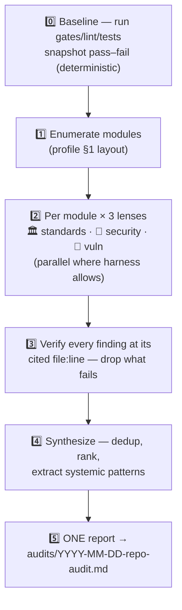

# Repo-audit — whole-repo fan-out through the kit's auditor lenses

Read-only. Reuses the three installed auditor personas (`standards-auditor`,
`security-auditor`, `vuln-auditor`) — same lenses that gate every module build, now swept across
**all** modules at once, plus a synthesis pass the per-module gate can't do: cross-module
de-duplication and **systemic patterns** (a defect that appears in N modules is one finding with
N locations, and its fix is a template/profile fix, not N patches).

## Run it (orchestrator playbook)

0. **Baseline.** Run profile §2 gate + test commands; record pass/fail verbatim. A red baseline
   is itself finding #1 — note it and continue (the audit still runs; it just can't claim a
   clean floor).
1. **Enumerate** modules from the profile §1 layout (plus shared/core layers as one extra
   "module" audited with the standards lens only — its rules differ, per profile §4/§5).
2. **Fan out.** For each module, dispatch the three auditor personas with the module path as
   scope (not a diff — whole-module review). Claude Code: parallel Agent calls, several modules
   at a time. Other harnesses: sequential fresh sessions per `adapters/generic.md` — order
   doesn't matter, seats are independent.
3. **Verify before accepting** (same rule as the pipeline reviewer): open each finding's cited
   `file:line`; drop what doesn't hold, and say how many were dropped per lens (a high drop rate
   is a persona-tuning signal).
4. **Synthesize:**
   - de-duplicate across modules and lenses (keep highest severity, merge locations);
   - extract **systemic patterns** — same defect class in ≥2 modules ⇒ one systemic finding with
     a root-cause fix (template fix, profile §7 invariant addition, new hook/gate) ranked above
     its instances;
   - rank: systemic → blockers → warnings → nits.
5. **Report** to `audits/<date>-repo-audit.md`: baseline snapshot · verdict · systemic patterns
   (with the proposed template/profile/gate fix each) · ranked findings table
   (`severity · rule · module · file:line · issue · minimal fix`) · per-lens drop counts ·
   modules swept vs skipped (**no silent caps** — if you sampled, say what was skipped).

## Rules

- Read-only throughout — no fixes during the audit (fixes become pipeline FIX-briefs or
  DEFERRED_TASKS rows; systemic fixes may warrant a `DECISIONS.md` ruling first).
- Evidence bar identical to the pipeline: no `file:line` + rule citation, no finding.
- Schedule it: the source project found 92 ledger findings precisely because nobody looked for
  six waves. Quarterly, or after every 3–5 modules.
